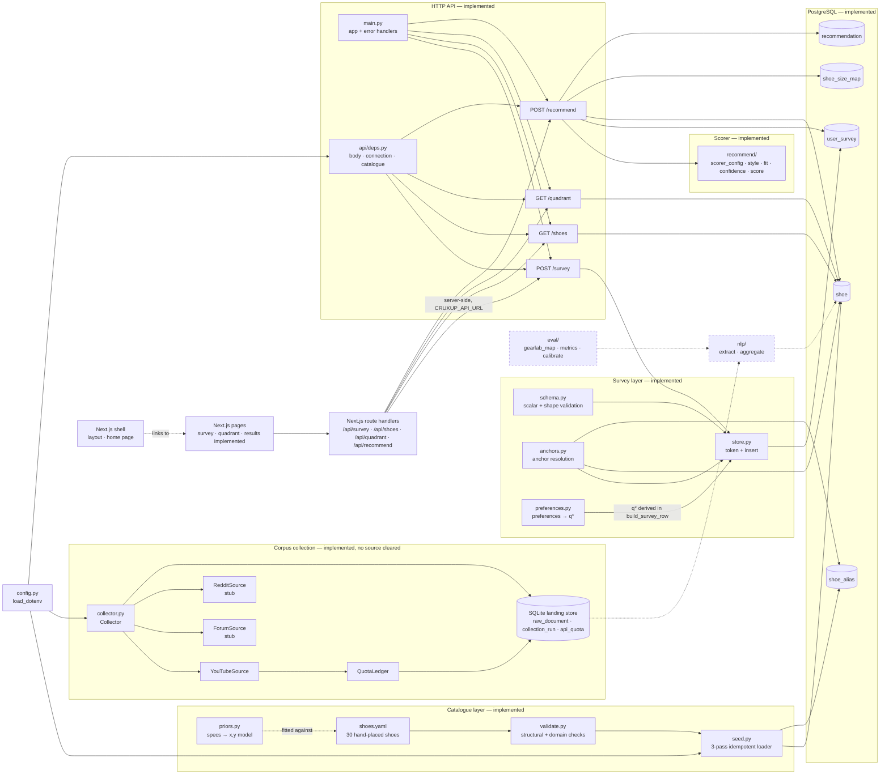
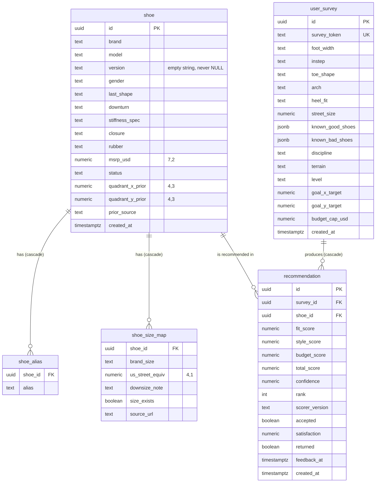

# CruxUp — Architecture

A reference for the structure, data model and design of the CruxUp climbing shoe recommender. It describes the software **as implemented** and marks where the planned design has not been built yet.

- **Last verified against the codebase:** 2026-11-06
- **Plan, tasks and decisions of record:** [`timeline.md`](../timeline.md). Decision IDs (D1–D12) and task IDs (W0-1a, …) below refer to it.
- **Local setup:** [`SETUP.md`](../SETUP.md)
- **Verification:** the commands at the foot of this document re-check the claims that can be checked mechanically.

---

## 1. System overview

- **Purpose:** recommend climbing shoes on three independent dimensions:
  - **Fit** — does the shoe suit the user's foot? (questionnaire + anchor shoes)
  - **Style** — does the shoe's character match the user's discipline and preferences? (a 2-D quadrant)
  - **Budget** — is it within the user's price limit?
- **The quadrant plane** is the core abstraction. Every shoe and every user target is a point in `[-1,1]²`:
  - `x`: comfort (−1) ↔ performance (+1)
  - `y`: stiff (−1) ↔ soft (+1)
  - Q1 performance+stiff · Q2 comfort+stiff · Q3 comfort+soft · Q4 performance+soft
- **Placement provenance.** A shoe's position has one of three sources, ranked by confidence: **corpus** (aggregated community discussion) > **hand** (human judgement) > **spec** (derived from manufacturer specifications). The source is stored with every placement.
- **Build state:**
  - **Implemented:** the product database schema, the shoe catalogue and its validator, a spec-to-placement model, the catalogue loader, environment configuration, a source-agnostic corpus collector, survey capture (§4.7), preference→target (`q*`) derivation and its wiring into capture (§4.8), an HTTP API with `POST /survey`, `GET /shoes`, `GET /quadrant` and `POST /recommend` (§4.9), the minimal v0-slice scorer (§4.13), the frontend shell with its component and end-to-end test harness (§4.10), the questionnaire with its browser → route handler → FastAPI path (§4.11), the interactive quadrant chart and table (§4.12), and the ranked results page with its `/api/recommend` route handler and confidence display (§4.14).
  - **Not implemented:** NLP extraction and aggregation, evaluation, and the full W3-3 scorer (sizing map and corpus-backed confidence). The NLP and eval modules exist as documented stubs (§7). The questionnaire, the quadrant page and the results page are reachable from the browser through the route handlers (§4.11, §4.12, §4.14). The thin slice is code-complete but not deployed; a rate limit in front of the unauthenticated POST routes is a deployment prerequisite (`timeline.md` §13).
- **Current binding constraint:** **no corpus source is cleared.** YouTube collection failed a terms review, Reddit access is pending, and forum terms are unreviewed (`timeline.md` §10.2; D11 reopened). The planned first release (D7) is designed to work **without** a corpus, on hand- and spec-derived placements.

---

## 2. Component diagram

Solid boxes are implemented; dashed boxes are stubs or planned.



---

## 3. Repository layout

| Path | Role | Status |
|---|---|---|
| `backend/app/catalog/data/shoes.yaml` | Seed catalogue; source of truth for shoes | Implemented |
| `backend/app/catalog/validate.py` | Catalogue validation | Implemented |
| `backend/app/catalog/priors.py` | Spec → quadrant placement model | Implemented |
| `backend/app/catalog/seed.py` | Catalogue → PostgreSQL loader | Implemented |
| `backend/app/catalog/sizing.py` | Per-brand sizing map | Stub |
| `backend/app/config.py` | `.env` loading | Implemented |
| `backend/app/db/migrations/0001_init.sql` | Product schema | Implemented |
| `backend/app/db/migrations/0001_init_down.sql` | Reversal of the above | Implemented |
| `backend/app/db/client.py`, `models.py` | Database client, typed models | Stub |
| `backend/app/scraping/collector.py` | Collector, sources, quota ledger, landing store | Implemented |
| `backend/app/scraping/{sources,youtube,reddit,rate_limiter,compile,mentions}.py` | Originally planned per-module split for collection | Stub (§7) |
| `backend/app/main.py`, `backend/app/api/deps.py` | FastAPI app, error handlers; body parsing, connection and catalogue dependencies | Implemented (§4.9) |
| `backend/app/api/routes/survey.py`, `shoes.py`, `quadrant.py` | `POST /survey`, `GET /shoes`, `GET /quadrant` | Implemented (§4.9) |
| `backend/app/api/routes/recommend.py` | `POST /recommend` | Implemented (§4.9) |
| `backend/app/survey/` | Survey capture: `schema.py` validation, `anchors.py` catalogue resolution, `store.py` persistence; `preferences.py` preference → `q*` derivation | Implemented (§4.7, §4.8) |
| `backend/app/recommend/` | Scorer: `scorer_config.py` constants, `style.py`, `fit.py`, `confidence.py`, `score.py` | Implemented (§4.13) |
| `backend/app/nlp/` | Extraction, aggregation, lexicon, distillation | Stub |
| `backend/app/eval/` | Calibration and metrics | Stub |
| `backend/tests/` | Tests: 12 implemented files (including `test_frontend_contract.py` and the scorer's six), 2 stubs (`test_aggregate.py`, `test_calibration.py`) | Partial |
| `backend/data/` | Local data: `gearlab/` placeholder; landing store (gitignored) | Runtime |
| `frontend/` | The Next.js application, a self-contained npm project with its own manifest, lockfile, configuration and `.gitignore`. The repository root has no `package.json` | Implemented (§4.10) |
| `frontend/src/app/layout.tsx`, `page.tsx`, `globals.css` | Next.js App Router root layout, home page, global stylesheet with design tokens | Implemented (§4.10, §4.11) |
| `frontend/src/app/survey/` | Questionnaire page, form and anchor picker | Implemented (§4.11) |
| `frontend/src/app/results/` | Ranked results page, cards and state view | Implemented (§4.14) |
| `frontend/src/app/api/survey/route.ts`, `api/shoes/route.ts`, `api/quadrant/route.ts`, `api/recommend/route.ts`, `lib/backend-proxy.ts` | Next.js route handlers and the server-side FastAPI proxy | Implemented (§4.11, §4.14) |
| `frontend/src/app/quadrant/`, `components/QuadrantChart.tsx`, `QuadrantTable.tsx`, `lib/quadrant-scale.ts`, `quadrant-labels.ts`, `format-axis-value.ts`, `shoe-label.ts` | Quadrant page, interactive chart and table, and their shared helpers | Implemented (§4.12) |
| `frontend/src/app/lib/api.ts`, `types.ts`, `survey-payload.ts`, `survey-token.ts` | Browser API client, types pinned to `schema.py`, payload converter, sessionStorage key | Implemented (§4.11) |
| `frontend/e2e/fake-backend.mjs` | Stub FastAPI for the Playwright run | Test support (§4.11) |
| `frontend/src/app/**/*.test.ts(x)`, `frontend/e2e/*.spec.ts` | Component and unit tests (Vitest) and end-to-end specs (Playwright) | Implemented (§4.10, §4.11, §11) |
| `frontend/package.json`, `frontend/package-lock.json` | npm manifest, scripts and committed lockfile | Implemented (§10.2) |
| `frontend/vitest.config.mts`, `vitest.setup.ts`, `playwright.config.ts` | Test-runner configuration | Implemented (§4.10) |
| `.github/workflows/ci.yml` | Continuous integration: two backend jobs and one frontend job | Implemented (§11) |
| `scaffold.sh` | Non-destructive generator for the stub tree (54 `stub` entries; writes only files that do not exist) | Tooling |
| `backend/scraping/`, `backend/NLP/` | Empty files from an earlier layout | Dead code (§12) |
| `timeline.md`, `SETUP.md` | Plan of record; local setup | Docs |

---

## 4. Implemented components

### 4.1 Catalogue — `backend/app/catalog/data/shoes.yaml`
- **Shape:** a mapping root with a `shoes` list. Each entry has `brand`, `model`, optional `version`, `gender`, `last_shape`, `downturn`, `stiffness_spec`, `closure`, `rubber`, `msrp_usd`, `quadrant_x_prior`, `quadrant_y_prior`, `prior_source`, `aliases`, and optional `anchor` and `note`.
- **Contents:** 30 shoes and 71 aliases, all `prior_source: hand`. `msrp_usd` is set on 23 rows (2026-11-05): 19 from the brand's US site and 4 medium-confidence list prices (Testarossa, Altura, Aragon, Hiangle). It is null on 7 (Anasazi Pro, Mythos, Maestro Mid, Astroman, Katana Velcro, Elektra, Moccasym). Each value's source and confidence sit in a `# msrp:` comment above it. A null is an unresolved price, not a zero, so `validate.py --require-msrp` fails by design until the seven are resolved.
- **Anchors:** five shoes marked `anchor: true` are calibration ground truth for the quadrant — La Sportiva Solution (Q1), La Sportiva TC Pro (Q2), Evolv Defy (Q3), Scarpa Drago (Q4), Scarpa Instinct VSR (Q4).
- **Identity:** `(brand, model, version, gender)`. A `version` that changes the last is a separate shoe — the Solution (Q1) and Solution Comp (Q4) are separate rows in different quadrants.
- `anchor` and `note` are metadata and documentation; they are not persisted.

### 4.2 Catalogue validation — `backend/app/catalog/validate.py`
- **Interface:** `validate(path=CATALOG, require_msrp=False) -> list[str]` (an empty list means valid); `quadrant(x, y) -> str`; CLI `python3 backend/app/catalog/validate.py [--catalog PATH] [--require-msrp]`, exit code 1 on errors.
- **Order of checks:** structure first (a mapping root, `shoes` as a list, each entry a mapping); then field types (identity fields are strings; priors and `msrp_usd` are numbers, not booleans; `aliases` is a list of strings); then domain rules. Malformed input returns errors and never raises.
- **Domain rules** (several mirror database constraints so failures surface before load):
  - count within `MIN_SHOES`–`MAX_SHOES` (currently 25–30)
  - the five anchors are marked `anchor: true` and land in their expected quadrants
  - `gender`, `downturn` and `closure` enums match the SQL `CHECK` constraints
  - `prior_source` ∈ {`corpus`, `hand`, `spec`}, present exactly when coordinates are present
  - priors lie in `[-1,1]` and not exactly on an axis
  - `(brand, model, version, gender)` is unique
  - aliases are unique across the whole catalogue, case-insensitively
- **Budget-gate guard:** by default null prices only warn; `--require-msrp` makes them errors. This check must pass before any budget filtering relies on prices. Today it warns 7/30 and `--require-msrp` fails on those seven (§4.1).

### 4.3 Placement model — `backend/app/catalog/priors.py`
- **Interface:** `derive_prior(shoe: dict) -> (x, y)`; `refit(shoes) -> dict` (weights plus LOOCV scores); `quadrant(x, y)`; the `PriorSource` enum (`CORPUS`, `HAND`, `SPEC`); CLI `python3 backend/app/catalog/priors.py [--refit] [--catalog PATH]`.
- **Model:** linear, over an 18-feature vector:
  - bias
  - one-hot `downturn` (3), `last_shape` (3), `stiffness_spec` (6), `closure` (3)
  - interaction `flat_and_stiff` — a flat last with a stiff or moderate-stiff midsole
  - interaction `soft_slipper` — a slipper closure with a soft or very soft midsole
- **Why the interactions:** a flat last alone predicts comfort, but a flat *and* stiff shoe is a precision edging shoe. `flat_and_stiff` carries x-weight +0.322.
- **Output contract:** clamped to `[-1,1]`; an exact zero is nudged to −0.001 (the comfort/stiff side) so every placement has a quadrant; rounded to 3 decimals to match `NUMERIC(4,3)`.
- **Fitting:** `refit()` fits by numpy least squares and scores the fit under leave-one-out cross-validation. `WEIGHTS` holds the checked-in output of `refit()` on the hand-placed set, so behaviour is deterministic and reproducible. numpy is needed only for refitting; `derive_prior()` is pure Python.
- **Measured accuracy** on the 30 hand-placed shoes: LOOCV MAE x **0.139**, y **0.113**; quadrant agreement **26/30 (87%)**.
- **Role:** makes catalogue growth cheap — a new shoe needs manufacturer spec fields, not a per-shoe judgement call.
- **Limitation:** the model is fitted to a single rater's placements, so its accuracy is agreement with that rater. An independent rater panel is planned (W0-4a).

### 4.4 Catalogue loader — `backend/app/catalog/seed.py`
- **Interface:** `load_catalog(path) -> list[dict]` (validates first; raises `ValueError` if invalid); `seed(conn, shoes, dry_run=False) -> SeedResult`; CLI `python3 backend/app/catalog/seed.py [--catalog PATH] [--database-url URL] [--dry-run]`.
- **Persisted columns** (`COLUMNS`, 13): `brand, model, version, gender, last_shape, downturn, stiffness_spec, closure, rubber, msrp_usd, quadrant_x_prior, quadrant_y_prior, prior_source`.
- **Algorithm — three passes in one transaction:**
  1. Upsert every shoe with `INSERT … ON CONFLICT (brand, model, version, gender) DO UPDATE … RETURNING id, (xmax = 0)`, collecting each ID and whether it was inserted or updated.
  2. `DELETE FROM shoe_alias WHERE shoe_id = ANY(<all collected ids>)`.
  3. Insert every shoe's current aliases.
- **Why three passes:** aliases are unique across the whole table, so per-shoe delete-and-insert depends on order. An alias moving from a later catalogue entry to an earlier one collides with the not-yet-deleted row and aborts the transaction; clearing every affected alias first removes the dependency.
- **Idempotency:** re-seeding an unchanged catalogue updates rows in place. Shoe UUIDs survive re-seeds, which matters because `recommendation.shoe_id` references them.
- **Normalisation:** `version` becomes `''` rather than NULL — NULL never equals NULL, which would defeat the upsert. `gender` defaults to `unisex`.
- **Replace, not merge:** removing an alias from the catalogue removes it from the database.
- **Failure behaviour:** invalid catalogue → exit 1 before any connection; missing `DATABASE_URL` → exit 2; missing `shoe` table → exit 1 with a migration hint; connection failure → exit 1; `--dry-run` rolls back.

### 4.5 Configuration — `backend/app/config.py`
- **Interface:** `load_dotenv(path=None, override=False) -> list[str]`; `configured(*keys) -> dict[str, bool]`; `PROJECT_ROOT`; `DEFAULT_ENV` (the repository-root `.env`).
- **Semantics:**
  - Returns the **names** of the keys it set, never values; `configured()` returns booleans. Secrets cannot leak through return values.
  - Variables already in the process environment take precedence over the file unless `override=True`.
  - Supports `#` comments, an `export ` prefix, spaces around `=`, and one pair of matching surrounding quotes. An empty assignment means *unset*.
  - A missing file returns `[]`, so real environment variables work identically without a file.
- **Dependency choice:** standard library only, so entry points cannot fail to start over an unrelated package.
- **Variables read by implemented code:**

| Variable | Used by | Required |
|---|---|---|
| `DATABASE_URL` | `seed.py` | For seeding |
| `CRUXUP_AUTHOR_SALT` | `collector.py` | For collection — no default |
| `YOUTUBE_API_KEY` | `YouTubeSource` | Source skipped without it |
| `REDDIT_CLIENT_ID`, `REDDIT_CLIENT_SECRET`, `REDDIT_USER_AGENT` | `RedditSource` | Source skipped without them |

- `SUPABASE_URL`, `SUPABASE_KEY` and `ANTHROPIC_API_KEY` appear in `.env.example` but are not read by any implemented code.

### 4.6 Corpus collector — `backend/app/scraping/collector.py`

#### Structure
- **`Source`** (abstract): `available() -> (bool, reason)` never raises, and unavailability is a normal state; `collect(query, limit) -> list[RawDocument]`.
- **`RawDocument`** (frozen dataclass): `source`, `external_id`, `body`, `permalink`, `created_utc`, `author_hash`, `payload`.
- **`YouTubeSource`** is implemented. **`ForumSource`** and **`RedditSource`** implement `available()`, but their `collect()` raises `NotImplementedError`.
- **`Collector`** runs every *available* source over every query:
  - skips unavailable sources with a log line
  - records every run
  - stops a source on `NotImplementedError`
  - isolates other per-query failures
  - waits 1 s between queries
- **`LandingStore`** — a local SQLite store, `backend/data/corpus_landing.sqlite3` by default.
- **`QuotaLedger`** — persistent quota accounting (below).
- **CLI:** `python3 backend/app/scraping/collector.py [--limit N] [--db PATH] [--status] [-v]`. `--status` prints documents per day and today's quota usage.

#### YouTube adapter
- Calls `search.list` (type `video`, `relevanceLanguage=en`, `videos_per_query` = 5 by default), then `commentThreads.list` per video (`textFormat=plainText`, `order=relevance`, paginated up to the limit).
- **Transport is injectable** (`fetch`), so the adapter is fully testable offline. The default transport uses stdlib `urllib` and maps HTTP 403 quota responses to `QuotaExceeded`.
- A video with comments disabled is skipped without failing the run; an unparseable timestamp keeps the document with `created_utc = None`; empty comment bodies are dropped.
- **Stored per document:** the comment ID as `external_id`, the text, a permalink (`watch?v=<video>&lc=<comment>`), the timestamp, the author hash, and `payload = {video_id, like_count}`. `authorDisplayName` is never stored.

#### Quota accounting
- **Buckets**, following YouTube's published quota model:

| Bucket | Endpoints | Cost | Daily limit |
|---|---|---|---|
| `youtube.search` | `search.list` | 1 per call | 100 calls |
| `youtube.units` | all others, including `commentThreads.list` | 1 per call | 10,000 units |

- **Reserved before the request.** YouTube charges quota for every request, including invalid ones, so quota is reserved atomically first: `INSERT OR IGNORE` the day's row, then `UPDATE … SET used = used + cost WHERE used + cost <= limit`. Zero rows updated means `QuotaExceeded`.
- **Persistence:** counters live in the landing store keyed by `(day, bucket)`, so separate processes on the same day share one budget.
- **Day boundary:** `America/Los_Angeles`, matching YouTube's midnight-Pacific reset.
- **On exhaustion,** `collect()` returns the documents gathered so far rather than failing.
- `QuotaLedger.in_memory()` exists for tests and library use; the CLI always injects the persistent ledger.

#### Author pseudonymisation
- `author_hash = HMAC-SHA256(key = CRUXUP_AUTHOR_SALT, message = author channel ID)`, hex-encoded.
- The key is read **when a hash is computed**, not at import, so a value loaded from `.env` after import is honoured.
- **Fails closed:** there is no default key. A missing key, one shorter than 32 characters, or a known-compromised value raises `MissingAuthorSalt`. The CLI checks the key after loading configuration and exits with code 2 **before any network request**.
- **The key is a secret.** Author IDs are public, so anyone holding the key could recompute hashes for candidate IDs. Changing the key makes previously stored hashes incomparable.

#### Landing store schema (SQLite)
| Table | Key | Columns |
|---|---|---|
| `raw_document` | `(source, external_id)` | `body, permalink, created_utc, author_hash, payload_json, collected_at` |
| `collection_run` | `id` | `started_at, finished_at, source, query, fetched, inserted, error` |
| `api_quota` | `(day, bucket)` | `used` |

- `INSERT OR IGNORE` on the primary key makes collection idempotent across restarts.
- The landing store holds raw payloads. Normalising them into the PostgreSQL corpus schema is planned (W1-full). **Retention is set by each source's terms** — YouTube caps stored data at 30 days.
- The store is gitignored (`backend/data/*.sqlite3`) and **currently empty**.

---

### 4.7 Survey capture — `backend/app/survey/`

Loads one questionnaire submission into `user_survey`. It adds no DDL: the table
and its CHECK constraints already exist in `0001_init.sql`, and this layer is the
validation and loading path in front of them.

#### Structure
- **`schema.py`** — `validate(payload) -> list[str]`. Scalar fields and top-level
  shape only; accumulates every problem rather than raising on the first, matching
  `catalog/validate.py`. CLI: `python3 backend/app/survey/schema.py <payload.json>`.
- **`anchors.py`** — resolves anchor sets *G* (`known_good_shoes`) and *B*
  (`known_bad_shoes`) against the catalogue.
  - **`CatalogLookup`** (Protocol) with two implementations: **`StaticCatalog`**
    (in-memory, used by the hermetic tests) and **`PostgresCatalog`** (reads
    `shoe` / `shoe_alias` from an already-open connection, never opening its own).
  - **`CatalogShoe`** (frozen dataclass) projects exactly `shoe_unique_identity`
    plus the id.
  - `resolve_anchors(good, bad, catalog)` returns resolved lists plus errors.
- **`store.py`** — `build_survey_row()` derives q* from `goal` (§4.8), then merges both validation
  stages into one error list; `insert_survey()` writes one row in a single transaction. CLI:
  `python3 backend/app/survey/store.py <payload.json> [--dry-run]`.

#### Vocabularies and the schema they mirror
`schema.ENUMS` mirrors five CHECK constraints (`survey_width_valid`,
`survey_instep_valid`, `survey_toe_valid`, `survey_arch_valid`,
`survey_disc_valid`). A test parses those constraints back out of the migration
and asserts equality, so the two cannot drift silently.

`heel_fit`, `terrain` and `level` have **no** CHECK constraint in the schema, so
they are validated only in Python (`schema.PY_ONLY_ENUMS`). This asymmetry is
deliberate and tracked — see §12.

#### Resolution rules
- Matching is case-insensitive on `(brand, model)`, narrowed by an optional
  `version` and/or `gender`.
- **An ambiguous name is an error, never a guess.** Three catalogue entries share
  a `(brand, model)` pair and differ only by version — Scarpa Instinct (VS/VSR),
  La Sportiva Katana (Lace/Velcro), La Sportiva Solution (base/Comp). Two are §3
  calibration anchors, so silently picking one would corrupt calibration-grade
  input. The error lists every candidate.
- A registered `shoe_alias` used as the `model` is an unambiguous disambiguator,
  because `shoe_alias_globally_unique` is unique across the catalogue. It is tried
  only when the identity match found nothing, so a bare shared name stays
  ambiguous regardless of whether it happens to also be an alias.
- `size` is opaque to the catalogue: it is never gated against `shoe_size_map`
  (D9 makes `size_exists` the only hard sizing gate, decided downstream).
- The same shoe in both *G* and *B* is contradictory and is rejected.

#### Input constraints
- **Allow-lists, not deny-lists.** Unknown top-level keys and unknown anchor
  sub-keys are rejected outright, so an identifier cannot ride into storage
  through an unmodelled field (D4). `shoe_id` is an *output* of resolution and is
  refused as an input, so a caller cannot point an anchor at an arbitrary shoe.
- **`size` is bounded in length and character set.** A length cap alone is not
  sufficient — an email address is short — so the characters a brand size is
  actually written with are enumerated, which rejects an address on `@`.
- Free text is rejected if it carries a NUL byte or a lone UTF-16 surrogate;
  both are representable in a Python string but not storable, and would otherwise
  surface as an exception from inside the driver rather than a validation error.
- The number of anchors per submission is capped, because each one costs a
  catalogue round trip. The cap short-circuits resolution, so an oversized
  submission performs no lookups at all.
- Numeric fields are checked against their column **scale**, not merely their
  range: PostgreSQL silently *rounds* a value that exceeds a `NUMERIC` scale
  rather than rejecting it, so a submission could otherwise validate clean and be
  stored as a different number. The comparison carries a float tolerance, because
  `q*` is computed upstream and binary-float noise is expected.

#### Identity
`survey_token` is generated with `secrets.token_urlsafe` (CSPRNG) and is the only
identity written. It is never accepted from a submission.

### 4.8 Preference → target — `backend/app/survey/preferences.py`

Maps a user's preference answers to `q*`, the point on the quadrant plane their
recommendations are steered toward (`timeline.md` §7.5). The Style score (§7.3)
measures each shoe's distance from this point. Pure arithmetic: no database, no
IO, standard library only.

#### Interface
- **`target_quadrant(discipline, terrain=None, level=None, goal=None) -> (x, y)`**
  - `discipline` is required: `boulder`, `sport`, `trad` or `gym`.
  - `terrain` (`slab`, `vertical`, `overhang`, `crack`) and `level` (`beginner`,
    `intermediate`, `advanced`, `elite`) are optional.
  - `goal` is an optional comfort-vs-performance slider value in `[-1, 1]`
    (−1 comfort, +1 performance).
  - An omitted input contributes nothing.
  - The coordinates are rounded to 3 decimal places, the scale of
    `goal_x_target` / `goal_y_target` (`NUMERIC(4,3)`), so `q*` can be stored
    without PostgreSQL rounding it again.
- **`quadrant_of(q) -> "Q1" … "Q4"`** labels a point per §1. It raises on a
  point that lies on an axis or has a non-finite coordinate.
  `catalog/priors.quadrant()` classifies shoe placements on the same plane but
  returns an `ON-AXIS` label instead of raising. It is not shared because
  `priors.py` depends on PyYAML.

#### Mapping
Discipline chooses the quadrant. The other inputs only move `q*` *within* it.

| Input | Value | Contribution (x, y) | Rationale (`timeline.md` §3) |
|---|---|---|---|
| discipline | `sport` | (+0.55, −0.55) | Q1: performance + stiff |
| discipline | `trad` | (−0.55, −0.55) | Q2: comfort + stiff |
| discipline | `gym` | (−0.55, +0.55) | Q3: comfort + soft |
| discipline | `boulder` | (+0.55, +0.55) | Q4: performance + soft |
| terrain | `vertical` | (+0.15, −0.15) | toward Q1: technical face, edging |
| terrain | `crack` | (−0.15, −0.15) | toward Q2: all-day, multi-pitch |
| terrain | `slab` | (−0.15, +0.15) | toward Q3: slabs |
| terrain | `overhang` | (+0.15, +0.15) | toward Q4: steep terrain |
| level | `beginner` → `elite` | x only: −0.15, −0.05, +0.05, +0.15 | beginners sit on the comfort side |
| goal | `g ∈ [−1, 1]` | x only: 0.15 · g | the comfort ↔ performance axis |

The two magnitudes are named constants, `BASE_MAGNITUDE = 0.55` and
`NUDGE = 0.15`. The tables are read-only mappings.

#### Invariant: `q*` always lies inside its discipline's quadrant
On any axis, at most three nudges can oppose the discipline's sign, which caps
the total at 3 × 0.15 = 0.45. That is less than the 0.55 base, so for **every**
combination of inputs:

- `|x|` and `|y|` are at least 0.10. `q*` never lies on an axis, where no
  quadrant is defined, and never crosses into another quadrant.
- `|x|` and `|y|` are at most 0.55 + 0.45 = 1.00. `q*` stays inside `[-1, 1]²`,
  and the clamp in the code never changes a value.

This holds by construction, not by clamping. The module checks both
inequalities when it is imported and raises `RuntimeError` if a change to the
constants breaks them. The check is an explicit `raise` rather than `assert`,
because `python -O` removes assert statements.

#### Validation
- Inputs are checked in the order discipline, terrain, level, goal. The first
  problem raises `ValueError`, naming the field and its allowed values.
- A `bool` is not accepted as a number.
- `goal` must be finite and within `[-1, 1]`. An integer too large to convert to
  a float is rejected with `ValueError`, not `OverflowError`.
- Unlike `schema.validate()`, errors are not accumulated. The function sits
  downstream of submission validation, not in front of a form.

#### Vocabulary
The function keys its tables to the same vocabularies `survey/schema.py`
accepts. `preferences.py` does not import `schema.py`, so tests pin the two
together: the discipline, terrain and level keys, and the output precision
(`OUTPUT_DECIMALS` = `schema.GOAL_TARGET_DECIMALS`).

#### Not yet modelled
- **Stiffness preference** and **downsizing/pain tolerance** are listed in §7.5
  but have no mapping and no `user_survey` column.
- **The raw answer is not stored.** `store.build_survey_row()` calls this
  function and keeps only the derived targets. Nothing stores the raw `goal`, so
  a stored target cannot be recomputed if the constants change. See §12.

### 4.9 HTTP API — `backend/app/main.py`, `backend/app/api/`

A FastAPI service over the survey layer (§4.7), the catalogue (W7-1) and the
scorer (§4.13). It has four endpoints. `POST /recommend` (W7-2) ranks one survey.

| File | Role |
|---|---|
| `main.py` | `create_app()` factory and module-level `app`; mounts all four routers; exception handlers |
| `api/deps.py` | `json_body` (request-body parsing), `survey_token_body` (the `POST /recommend` body), `database_url()`, `get_conn()` (one connection per request), `get_catalog()` |
| `api/routes/survey.py` | `POST /survey` |
| `api/routes/shoes.py` | `GET /shoes` |
| `api/routes/quadrant.py` | `GET /quadrant` |
| `api/routes/recommend.py` | `POST /recommend` |

- **Running:** `cd backend && uvicorn app.main:app`, which binds `127.0.0.1:8000`
  by default. `app` is a package rooted at `backend/`. The survey modules are
  imported flat through their own directory, the way `store.py` imports its
  siblings, so the service and `store.py` share one `anchors` module object.
- **`POST /survey`** is a thin wrapper. It calls
  `build_survey_row(payload, PostgresCatalog(conn))`, then
  `insert_survey(conn, row)`. It has no request model and no checks of its own,
  so its rules cannot drift from `survey/`.

  | Outcome | Status | Body |
  |---|---|---|
  | Valid submission | 201 | `{"survey_token": "..."}`; nothing else is echoed |
  | Invalid submission | 422 | `{"errors": [...]}`: `build_survey_row`'s list verbatim, every error in one response. Nothing is written |
  | Body does not parse (malformed syntax, invalid UTF-8, nesting past the parser's recursion limit) | 422 | `{"errors": ["request body is not valid JSON"]}` |
  | Database unreachable, or `DATABASE_URL` unset | 503 | `{"detail": "database unavailable"}` |
  | Any other database or unexpected error | 500 | `{"detail": "could not complete the request"}` |

  - **Non-object bodies:** a body that parses but is not an object (an array,
    string, number, `null` or empty body, or a non-JSON content type) is passed
    to `build_survey_row`, which rejects it. The API adds no shape rule of its own.
  - **Invalid submissions read but never write:** anchor resolution reads the
    catalogue even for an invalid submission, so every error is reported at
    once. Nothing is committed on that path; the connection is closed without a
    commit, which discards the read transaction.
- **Body parsing** happens in `deps.json_body`, not FastAPI's `Body()`.
  - FastAPI turns only a `JSONDecodeError` into its validation error. A
    `RecursionError` (deep nesting) or `UnicodeDecodeError` (invalid UTF-8)
    became a 400 of a different shape, which no handler saw and which was
    never logged.
  - `json_body` catches `(ValueError, RecursionError)`, the same pair
    `store.main()` catches. Otherwise it follows `Body()`'s rules: an empty
    body is `null`; JSON is parsed with no content type, or with
    `application/json` or `application/*+json`; any other content type passes
    through as raw bytes.
  - A test pins that `/survey` declares no request body or parameters to
    FastAPI, so the framework can never validate anything ahead of
    `build_survey_row`. As a consequence, `/docs` shows no request schema
    for `/survey`. The payload shape is `survey/schema.py` (§4.7), which is
    not duplicated in OpenAPI so the two cannot drift.
- **`GET /shoes`** returns every `shoe` row as
  `{id, brand, model, version, gender}`, ordered by brand, model, version and
  gender. `version` is `''` for a base model.
  - **Why `version` and `gender`:** they distinguish the three pairs that share
    `(brand, model)`. A test proves that every returned item, submitted back as
    an anchor, resolves to exactly its own `id`, so a picker built on this list
    cannot produce an ambiguous anchor.
  - **No `status` filter,** because anchor resolution matches shoes of any
    status.
  - **No pagination.** The catalogue has 30 rows today and ~100 under D12.
- **`GET /quadrant`** returns every shoe that has a quadrant prior, as `{id, brand, model, version, gender, x, y, prior_source, is_anchor, quadrant}`. It has its own router, because `GET /shoes` is pinned to identity columns for the anchor picker.
  - **Filter and order:** `quadrant_x_prior IS NOT NULL`. The paired CHECKs make `y` and `prior_source` all-or-nothing with `x`, so no further guard is needed. The order is `lower(brand), lower(model), version, gender, brand, model, id`, which is total.
  - **`is_anchor`** is membership of `(brand, model, version)` in `validate.ANCHORS`, the single source of the §3 anchors. Nothing is stored: `seed.py` drops the YAML flag and there is no column. The key has no gender, so a gendered twin of an anchor would be flagged too (`timeline.md` §13).
  - **`quadrant`** is `priors.quadrant(x, y)`. An on-axis prior is outside the `Q1`–`Q4` literal, so response validation fails and the handler returns the same masked 500 as any unexpected error. That is deliberate: `validate.py` treats an on-axis prior as a catalogue bug.
  - **Numbers:** `NUMERIC(4,3)` arrives as `Decimal` and is converted to `float`, so the JSON carries numbers.
  - **Parameters:** the SQL takes no bind parameters. The handler is a plain `def`, as the other routes are.
- **`POST /recommend`** ranks the active catalogue for one survey with the scorer in §4.13, and stores the ranking. The body must be exactly `{"survey_token": <token>}`.

  | Outcome | Status | Body |
  |---|---|---|
  | Ranking returned | 200 | `RecommendOut` (below) |
  | Unknown token | 404 | `{"errors": ["survey not found"]}` |
  | Body is not exactly that object, including an empty body | 422 | `{"errors": ['body must be {"survey_token": <token>}']}` |
  | Body is not valid JSON | 422 | `{"errors": ["request body is not valid JSON"]}` |
  | Database unreachable, or `DATABASE_URL` unset | 503 | `{"detail": "database unavailable"}` |
  | Any other failure, including a response that fails validation | 500 | `{"detail": "could not complete the request"}` |

  - **Body handling runs before any connection.** `deps.survey_token_body` is declared first on the route and reads the body through `json_body`, the same parser `POST /survey` uses. `get_conn` is declared after it, so a bad body never opens a database connection. The token must match `[A-Za-z0-9_-]{1,64}`. The 422 message is fixed and never echoes the submitted value. The route declares no request model, because FastAPI's own 422 echoes `input`.
  - **One transaction.** The survey row is read `FOR UPDATE`, so concurrent requests for one token serialise. Every shoe is read, with no status filter, because anchors must resolve against discontinued shoes; the scorer keeps only active candidates. Size rows are read only for the survey's street size. The token is only ever a bound parameter: it appears in no SQL text, body or log line.
  - **Upsert, then validate, then commit.** The ranking is upserted first (below). `RecommendOut` validation then runs, and it rejects NaN and infinity. Only after that does `conn.commit()` run, once. A validation failure raises, so the upsert is never committed: it becomes the generic 500, and `get_conn()`'s close rolls the transaction back.
  - **Upsert and delete.** Each ranked shoe is upserted on `(survey_id, shoe_id)`. The conflict clause rewrites only the scored columns, `scorer_version` and `created_at`. `accepted`, `satisfaction`, `returned` and `feedback_at` are never written, so §9.4 feedback survives a re-request. Rows for shoes the new ranking no longer contains are deleted, unless they carry feedback, which is kept as a record of what the user was shown. With an empty ranking, that deletes every feedback-free row.
  - **Response** (`RecommendOut`): `scorer_version`, `target` (`{x, y}` or null), `terms`, `gated_out`, `warnings` and `results`. Each result is a `QuadrantShoeOut` (§4.9, `GET /quadrant`) plus the scoring fields listed in §4.13. Because it extends that shape, the results page passes `QuadrantChart` its `target` and `highlightIds` props (§4.12, §4.14). `msrp_usd` is null when the price is unknown, and `price_unknown` is then true.
  - **Not in the endpoint:** a rate limit (a deployment prerequisite, `timeline.md` §13) and a gender filter (§12). The browser reaches it through `/api/recommend` (§4.11, §4.14).
- **Connections:** `get_conn()` opens one psycopg connection per request, with
  `connect_timeout=5`. The catalogue reads and the insert share it, and it is
  always closed. `POST /recommend` reads and writes on that one connection, and
  commits once. There is no pool, so concurrent requests each hold their
  own connection against the server's `max_connections`.
- **Configuration:** `DATABASE_URL` is resolved at request time, from the
  environment first and then `.env`. With no value, the API fails closed with
  a 503 rather than guessing a database.
- **Error hygiene:** response bodies are fixed strings, with no exception text,
  DSN, SQL or submitted content. The server log records only the exception
  class, the class of any chained cause, the method and the path.
- **Deliberately not in the service:**
  - no CORS middleware, because the browser never calls it directly (§8);
  - no request-size limit;
  - `/docs` and `/openapi.json` stay enabled.

  The Next.js route handlers (§4.11) are the internet-facing layer and own
  these controls (§12).
- **Preference targets:** `POST /survey` accepts the raw `goal`, and
  `build_survey_row()` derives `goal_x_target` / `goal_y_target` from it (§4.8,
  §6.4). The route code is unchanged (only its docstring), so its 422 list still equals
  `build_survey_row()`'s.

### 4.10 Frontend shell and test harness — `frontend/`

The minimum the Next.js App Router needs in order to build, plus the two test layers that later frontend work builds on (W6-0). The product pages and the browser → backend path are described in §4.11.

Everything in this section lives in `frontend/`, a self-contained npm project. Paths below are relative to it, and every `npm` command runs there.

#### Structure
| File | Role |
|---|---|
| `src/app/layout.tsx` | Root layout, a server component. Renders `<html lang="en">` and `<body>`, imports `globals.css`, and exports `metadata` (title `CruxUp` and a one-line description). |
| `src/app/page.tsx` | Home page, a server component: an `<h1>`, one sentence describing the product, and two `next/link`s, to `/survey` and `/quadrant`. |
| `src/app/globals.css` | Tailwind import and the design tokens (§4.11). |
| `src/app/survey/page.tsx`, `src/app/results/page.tsx` | Questionnaire (§4.11) and results (§4.14) pages. |
| `src/app/quadrant/page.tsx` | Quadrant page (§4.12). |
| `vitest.config.mts`, `vitest.setup.ts` | Component-test configuration and per-test setup. |
| `playwright.config.ts`, `e2e/` | End-to-end configuration and specs. |

#### Build output
- `next build` prerenders `/`, `/_not-found`, `/survey`, `/results` and `/quadrant` as static (○). The route handlers `/api/survey`, `/api/shoes`, `/api/quadrant` and `/api/recommend` are dynamic (ƒ). Verified 2026-11-06.
- Route handlers, client components, the questionnaire (§4.11), the quadrant (§4.12) and the results page (§4.14) exist. There is no middleware and no server action.
- **No web fonts are loaded.** `next/font/google` would download fonts during `next build`, which would make the build depend on network access.
- **Module alias:** `@/*` resolves to `src/*`, in both `tsconfig.json` and Vitest (`resolve.tsconfigPaths`). Nothing imports through it yet.

#### Test layers
| Layer | Tool | Location | Runs against | Covers |
|---|---|---|---|---|
| Component | Vitest 4 + React Testing Library | `src/**/*.test.{ts,tsx}` | jsdom | One component's rendered, accessible structure. Synchronous server components render directly. |
| End-to-end | Playwright, Chromium only | `e2e/*.spec.ts` | Next.js on port 3100 with a stub backend on port 3101 | Routing, the questionnaire's submit and error paths, the results journeys, the quadrant page's keyboard, tooltip and phone-width behaviour, and HTTP status. |

- **Vitest:**
  - `vitest.setup.ts` registers the `@testing-library/jest-dom` matchers and unmounts after every test.
  - Test APIs are imported explicitly rather than injected as globals.
  - Vitest includes only `src/`, and Playwright reads only `e2e/`, so neither runner picks up the other's files.
- **Async server components** cannot be rendered by React Testing Library. They belong to the Playwright layer.
- **Playwright server:**
  - Locally it starts `next dev` on port 3100 and the stub backend on 3101. A server already listening on either port is reused, so stop it first (§4.11).
  - When `CI` is set, it starts `next start` against the build made by the preceding CI step, so CI exercises production output.
  - Retries (2) and `forbidOnly` apply in CI only.
  - Port 3100 avoids colliding with a development server on the default 3000.

#### Toolchain
- **Location:** `frontend/` holds the manifest, lockfile, `tsconfig.json`, the ESLint, PostCSS, Next.js and test-runner configs, and a `.gitignore` for dependencies, build output and test artifacts. No lockfile exists above it, so Next.js treats `frontend/` as the project root without configuration.
- **Package manager:** npm, with a committed `package-lock.json` (lockfile v3). `npm ci` reproduces the install.
- **Pinning:** `next` and `eslint-config-next` are pinned exactly, at the same version. `engines.node` is `>=20.9.0`, the Next.js 16 minimum.
- **Lint:** ESLint 9 flat config, using `eslint-config-next` `core-web-vitals` + `typescript`. It ignores coverage and Playwright output. A `.venv/**` ignore entry remains from when the app lived at the repository root; it no longer matches anything.
  - Next.js 16's `next build` does not run ESLint, so lint is a separate CI step.
- **Type-check:** `tsc --noEmit` (`npm run typecheck`). `next build` also type-checks every file that `tsconfig.json` includes, test files and configs among them.
  - Its `**/*.ts`, `**/*.tsx` and `**/*.mts` include globs are scoped to `frontend/`, so the type-checker never reaches `backend/` or `.venv/`.

### 4.11 Questionnaire and browser → backend path — `frontend/src/app/`

The questionnaire (W6-1), the quadrant data (W6-2, §4.12), the ranked results (W6-3, §4.14) and the only route from the browser to the API. The browser never addresses FastAPI: it calls same-origin route handlers, which call FastAPI on the server (§8).

| File | Role |
|---|---|
| `api/survey/route.ts` | `POST /api/survey`: content-type check, 32 KB body cap, then forward |
| `api/recommend/route.ts` | `POST /api/recommend`: content-type check, 1 KB body cap, then forward (§4.14) |
| `api/shoes/route.ts` | `GET /api/shoes`: forward the catalogue; `force-dynamic`, so it is never baked in at build |
| `api/quadrant/route.ts` | `GET /api/quadrant`: forward the quadrant listing; `force-dynamic`, like `/api/shoes` |
| `lib/backend-proxy.ts` | `forwardToBackend()`: path allow-list, timeout, status mapping, response headers |
| `lib/json-request-body.ts` | `readJsonRequestBody()`: content-type, length and streamed-byte checks, shared by both POST routes |
| `lib/api.ts` | Browser client: `submitSurvey()`, `getShoes()`, `getQuadrant()`, `getRecommendations()`, `ApiError` |
| `lib/survey-payload.ts` | `toSurveyPayload()`: form state to the §7.1 payload |
| `lib/types.ts` | `Shoe`, `QuadrantShoe`, the enum arrays and `SurveyPayload`, pinned to the backend by contract tests |
| `lib/survey-token.ts` | The `sessionStorage` key for the survey token |
| `survey/page.tsx`, `SurveyForm.tsx`, `AnchorPicker.tsx` | Questionnaire page (server component), controlled form and anchor picker (client components) |
| `results/page.tsx`, `ResultsView.tsx` | Results page (§4.14) |

#### Data path
1. `lib/api.ts` calls `/api/survey` or `/api/recommend` (POST), or `/api/shoes` or `/api/quadrant` (GET), on the app's own origin.
2. The route handler checks the request, then calls `forwardToBackend(path, init, passthroughStatuses, fixedMessages?)`. A status in `passthroughStatuses` that has a fixed message gets that message in place of the upstream body; other passthrough statuses stream the upstream body.
3. `forwardToBackend` calls `${CRUXUP_API_URL}${path}` on the server. `CRUXUP_API_URL` is read at call time and defaults to `http://127.0.0.1:8000`. It has no `NEXT_PUBLIC_` prefix, so it is never inlined into the client bundle.
4. The browser receives the upstream body for an allow-listed status, or a fixed error envelope.

#### Route handler rules
- **Allow-list, no catch-all.** The path type is the union `"/survey" | "/shoes" | "/quadrant" | "/recommend"`, and there is one route file per endpoint.
- **`POST /api/survey`.** 415 unless `Content-Type` is `application/json`, which blocks cross-site HTML forms. 413 over 32 KB, checked on `Content-Length` and again on the bytes actually streamed. 400 if the client aborts mid-read. Only `content-type` is forwarded, so cookies and auth headers stay out of the backend. The body is neither parsed nor validated here.
- **`POST /api/recommend`.** The same sequence with a 1 KB cap, since a valid body is under 100 bytes. The body is forwarded as raw bytes and is never parsed or logged, because it carries the survey token.
- **Status allow-list.** `/survey` passes 201 and 422; `/shoes` and `/quadrant` pass 200; `/recommend` passes 200, 404 and 422, and its 404 and 422 bodies are replaced with fixed messages. Any other upstream status becomes 502, and 503 stays 503. A connection failure or redirect becomes 503 (`redirect: "error"`). A 10 s timeout becomes 504. There is no retry, because POST is not idempotent. Discarded upstream bodies are cancelled.
- **Responses.** Fixed `application/json`, `x-content-type-options: nosniff` and `cache-control: no-store`. The 201 carries the survey token. Errors are `{"errors": [fixed message]}`, the same shape as the backend's 422, so the client handles one error shape. This departs from the `{error: {code, message}}` shape used elsewhere, and it means error text never echoes the backend.
- **Logging.** A failure is logged server-side with the path and error class, never the URL.

#### Client (`lib/api.ts`)
- `submitSurvey(payload)`: 201 gives `{ok: true, surveyToken}`. 422 gives `{ok: false, errors}` with the server's messages verbatim, since they are the user-actionable validation errors.
- `getShoes()`: returns `Shoe[]`, with each element checked by a type guard rather than cast.
- `getQuadrant()`: returns `QuadrantShoe[]`. Each element is checked by `isQuadrantShoe`, which requires finite coordinates in [−1, 1], the gender, prior-source and quadrant enums, and a boolean `is_anchor`. Any other shape is `bad_response`.
- `getRecommendations()`: see §4.14.
- Anything else throws `ApiError` with a `code`: `unavailable` (network, 502, 503), `timeout` (504), `rejected` (400, 413, 415) or `bad_response` (unexpected status, non-JSON or wrong shape). The proxy's fixed message is shown, and the cause is preserved.

#### Payload (`lib/survey-payload.ts`)
- Unanswered selects, blank or non-finite numbers, a null goal and empty anchor lists are omitted, so no `null` or empty string is sent.
- `goal` is sent raw, in [−1, 1]. Targets are never sent; the route refuses them.
- Each anchor is `{brand, model, version, gender}`, plus `size` when entered. `version` is always sent (`""` for base models). `id` and `shoe_id` are never sent.
- There is no client-side validation. `schema.py` is the only validator.

#### Types (`lib/types.ts`)
- The enum arrays are `as const` and derive the unions. `test_frontend_contract.py` parses them, and the `AnchorEntry` keys, out of the source and compares them with `schema.py` and `anchors.py`, duplicates included. An edited enum fails pytest; a dropped `SURVEY_FIELDS` entry fails `tsc`. The quadrant arrays and the `QuadrantShoe` keys are pinned the same way, to `PriorSource` and `QuadrantShoeOut`.
- `SurveyPayload` has no `goal_x_target` / `goal_y_target` keys. They are typed `never`.

#### Questionnaire
- `survey/page.tsx` is a server component with metadata. `SurveyForm` is a controlled client component over `SurveyFormState`.
- **Fit:** foot width, instep, toe shape, arch and heel fit, each with "Prefer not to say", plus US street shoe size. US is used because `schema.py` caps the value at 20, which rules out EU sizes.
- **Preferences:** discipline, terrain, level, and a five-point comfort-vs-performance goal from −1 to 1. The goal is disabled until a discipline is chosen and resets when discipline is cleared, because q* is derived per discipline.
- **Budget**, and two `AnchorPicker`s fed by `getShoes()`. A failed catalogue load is non-blocking.
- `noValidate` is set, so input attributes are hints and the 422 path through `schema.py` remains the single validator. 422 errors render as text in a focused, labelled region (WCAG 3.3.1).
- An in-flight ref blocks double submission. On success the token goes to `sessionStorage` under `cruxup.surveyToken` (never the URL), and the page navigates to `/results`.

#### Anchor picker (`survey/AnchorPicker.tsx`)
- A hand-built WAI-ARIA APG combobox, with no new dependency. Free text would recreate the ambiguity the server rejects, because three catalogue pairs share `(brand, model)`.
- Filters case-insensitively across brand, model and version, one term per word. Shows at most 20 options and excludes shoes already picked. Labels read `Brand Model [Version] (gender)`.
- Arrow keys wrap, Enter selects, and Escape closes; a second Escape clears. A click reopens. `aria-activedescendant` tracks the active option, which scrolls into view and has a non-colour cue. `aria-expanded` is true only when there are options, and a polite live region announces the count.
- Picked shoes are listed with a labelled size input and a 44 px Remove button. Focus returns to the input after removal.
- Catalogue strings render as text only.

#### Results
- The results page is specified in §4.14 (W6-3). `SurveySaved`, the W6-1 placeholder, is removed.

#### Design tokens (`globals.css`)
- Semantic custom properties on `:root`, with a `prefers-color-scheme: dark` override and `color-scheme: light dark`: background, surface, foreground, muted, border, control-border, accent, accent-foreground, danger, warning and focus-ring. Tailwind v4 maps them to utilities through `@theme inline`, which also sets a control radius and system fonts.
- Contrast was computed for both themes. All text pairs meet WCAG AA. Control borders (`#71717a`) are 3.67–4.83:1 against their backgrounds, above the 3:1 floor for non-text UI (1.4.11). Focus uses a `:focus-visible` outline in the focus-ring colour.

#### End-to-end stub backend
- `playwright.config.ts` starts two servers. First, `e2e/fake-backend.mjs` on 127.0.0.1:3101 (Node `http`, no dependency), health-checked on `GET /shoes`. Then Next.js on 3100, with `CRUXUP_API_URL=http://127.0.0.1:3101`.
- The stub serves `GET /shoes` with a fixture that includes Scarpa Instinct VS/VSR, La Sportiva Solution base/Comp, and a synthetic Evolv Defy mens/womens gender pair. `GET /quadrant` returns eight shoes at their `shoes.yaml` coordinates, covering all four quadrants; the Scarpa Instinct VS is marked spec-derived to exercise that provenance, although `shoes.yaml` marks it hand. `POST /survey` returns 201 with token `e2e-token`, or a fixed 422 for the sentinel `budget_cap_usd` of 1. `POST /recommend` returns 404 for the sentinel token `e2e-expired-token`, 422 for a body that is not JSON, and a fixed five-shoe ranking for any other token. Any other route returns 404.
- The stub exists because the route handlers call FastAPI server-side. Playwright's `page.route` cannot intercept that call, and CI runs no backend.
- `reuseExistingServer` is on locally and off in CI, so a server already on 3100 or 3101 is reused. It may point at a different backend, so stop it first (`SETUP.md` §8).

Known gaps for this slice are in §12 and `timeline.md` §13 (W6-1, W6-2, W6-3 and W7-2 known gaps).

### 4.12 Quadrant chart and table — `frontend/src/app/quadrant/`, `components/`

The §3 quadrant as a page (W6-2). The page is static; the data is fetched in the browser from `/api/quadrant` (§4.11). The chart and the table render the same list, so the two views cannot disagree.

| File | Role |
|---|---|
| `quadrant/page.tsx` | Server component with metadata: an `<h1>`, an intro saying every position is an estimate, and `QuadrantView`. It names no source. |
| `quadrant/QuadrantView.tsx` | Client component. Calls `getQuadrant()` on mount, unmount-safe. One always-mounted status region; on failure, an alert with the `ApiError` message and a "Try again" button. The chart and the table each sit in a section headed by an `h2`. |
| `components/QuadrantChart.tsx` | Hand-built SVG chart: frame, labels, marks, keyboard model, tooltip, accessible names and legend. |
| `components/QuadrantTable.tsx` | The non-visual alternative (below). |
| `lib/quadrant-scale.ts` | `toChartPoint()`: maps `[-1, 1]²` onto a 480-unit square with 84-unit padding, and inverts y. |
| `lib/quadrant-labels.ts` | `QUADRANT_LABEL`: the §3 quadrant names, shared by chart and table. |
| `lib/format-axis-value.ts` | `formatAxisValue()`: two decimals with a true minus sign, never `−0.00`. |
| `lib/shoe-label.ts` | `toShoeLabel()`: brand, model and version, then gender in brackets. Shared with `AnchorPicker`, so disambiguation cannot drift. |

- **Axes and orientation.** x runs from comfort (−1) to performance (+1). y runs from stiff (−1) to soft (+1), with soft drawn at the top, so Q1 (performance and stiff) sits bottom-right. This follows the §3 axes, not mathematical quadrant numbering, and the scale tests pin it.
- **Encodings.** Provenance is shown by shape and fill, never colour alone: hand-placed is a filled circle, spec-derived a hollow one, and corpus a filled square. The corpus square is reserved, since no corpus rows exist. Marks have radius 5 units, or 7 for an anchor. Non-anchor hand-placed marks carry a 2-unit background-coloured ring so they stay visible over the gridlines; anchors have a 3-unit foreground outline. Spec-derived marks are hollow with a foreground outline. The five §3 anchors carry a direct label, and on the results page so does each highlighted point. The legend lists only the encodings on the page.
- **Quadrant labels** sit outside the frame, so no point or anchor label can cover one. Each corner label is split over two lines.
- **Text size.** The viewBox is 480 units, and axis, quadrant and anchor text is 18 units, so its rendered size follows the width the caller gives the chart. The plot area, inside the 84-unit label padding, is 223 px wide at a 375 px viewport (the SVG is 343 px), measured 2026-11-06. There the text is about 12.9 px.
- **Caller-controlled width.** The chart does not cap its own width (W6-3-H2). The results page wraps it in `max-w-sm` (a 384 px SVG at 1280 px, text 14.4 px). `/quadrant` wraps it in `max-w-xl` (a 576 px SVG at 1280 px, text 21.6 px), the W6-2 size, because about 30 shoes need the room to keep clusters apart.
- **Axis row.** The bottom axis labels are pinned 8 units above the viewBox bottom, leaving a full row of clear space below the corner labels (W6-3-H).
- **Hit areas.** Each point has a transparent circle of radius 20 units: 40 units across, about 27 px at 328 px, which clears the 24 px target size. Hit areas overlap in dense clusters; the keyboard reaches every shoe regardless.
- **Keyboard model.** Points are ordered from comfort to performance (by x, then soft before stiff, then label). A roving tabindex keeps one point in the Tab order, the last one focused. Right and Down step to the next point, Left and Up to the previous, Home and End jump to the ends, and nothing wraps. Each point is `role="img"` with `aria-roledescription="shoe"`. A visually hidden instruction on the group describes the one-dimensional order and the Escape key.
- **Accessible names and tooltip.** Both come from one helper, so they say the same thing, for example: "Scarpa Drago (unisex). Comfort–performance 0.80, leaning performance. Stiff–soft 0.85, leaning soft. Hand-placed." A value within 0.05 of zero reads "neutral". The tooltip appears on hover and on focus. Escape hides it; so does a pointer leaving, or a pointer-down outside the chart, because touch has no mouseleave and a tap elsewhere is how a hover tooltip is cleared. The tooltip is `aria-hidden` and `pointer-events-none`. Under WCAG 1.4.13 that is acceptable because it repeats the accessible name, so nothing in it needs hovering.
- **Results emphasis (W6-3).** `highlightIds` draws points as accent or muted, and spec-derived points stay hollow so provenance survives emphasis. Each highlighted point is labelled, on the right unless it does not fit there and the left has more room (W6-3-H2). `target` draws a crosshair named "Your target". The results page passes both (§4.14); `QuadrantView` passes neither.
- **Reference shoe.** The anchor legend entry and the table column read "Reference shoe", not "Section 3" (W6-3-H).
- **Table alternative** (`QuadrantTable`). Visible rather than sr-only, because hover cannot reach overlapping points and touch targets are small. It has one `tbody` per quadrant, headed by a row header, with columns for shoe, comfort–performance, stiff–soft, placement and reference shoe. An empty quadrant reads "No shoes". Each shoe cell carries a visually hidden quadrant cue, because screen-reader support for row-group headers is uneven. The table sits in a keyboard-reachable region (`role="region"`, `tabIndex` 0, labelled "All shoes by quadrant, scrollable") that scrolls horizontally, so the table scrolls inside itself and the page does not scroll sideways at 375 px.
- **Phone width.** The page pads `p-4` below `sm` and `p-8` above. Rendered screenshots at 375 px and 1280 px found a clipped x-axis label, a caption repeating its heading, and sideways scroll; W6-2-F2 and F3 fixed them. `e2e/quadrant.spec.ts` asserts no sideways scroll at 375 px.

### 4.13 Scorer — `backend/app/recommend/`

The minimal v0-slice scorer (W7-2, `timeline.md` §7). `recommend.score.recommend()` is a pure function that ranks one survey's candidate shoes; it does no IO. `POST /recommend` (§4.9) loads the rows, calls it and persists the result. This is not the full W3-3 scorer. Its weights are judgement-set and nothing is tuned (D8).

| Module | Role | Timeline |
|---|---|---|
| `scorer_config.py` | Every output-affecting constant, `SCORER_VERSION = "v0-slice"`, the Fit_cat tables, `ScoringError`, and `check_config()` | §7.2, §7.6, §7.7 |
| `style.py` | The Style term, and q* resolution from a stored survey row | §7.3, §7.5 |
| `fit.py` | Fit: the anchor term (Fit_anchor) and the categorical term (Fit_cat), blended by λ | §7.2 |
| `confidence.py` | Confidence C from survey completeness, anchors and placement source, with the label | §7.7 |
| `score.py` | `recommend(survey, shoes, size_rows) -> Ranking`: the gates, the combined score and the ranking | §7.6, D9 |

- **Constants.** Every output-affecting value lives in `scorer_config.py`. `check_config()` runs at import and raises `RuntimeError` for a negative weight, weights that do not sum to 1, a value outside [0, 1], table keys that differ from the enum key sets, or misordered label thresholds. `test_scorer_config.py` pins every value (`test_all_constants_are_pinned`), so an output-affecting edit appears in the diff beside `SCORER_VERSION`. That version is stored with each `recommendation` row (§5.3).
- **Formulas** (`timeline.md` §7 notation):
  - **Fit** = λ·Fit_anchor + (1−λ)·Fit_cat when both exist, otherwise whichever exists, otherwise the term is excluded. λ = 0.7.
    - **Fit_anchor.** A shoe's family is `(last_shape, downturn)`. Similarity is 1 − (|Δlast| + |Δdownturn|)/4 over 0/1/2 ordinals, and a NULL field counts as one step. With good anchors only, the score is the maximum similarity. With bad anchors only, it is 1 − the maximum. With both, it is the average of the two.
    - **Fit_cat** is the mean of the answered sub-scores: toe shape against last, foot width against last, and instep against closure. The tables are a domain judgement that **needs climber sign-off (W4'-3)**. `arch` and `heel_fit` are unused, because the catalogue has no field to match them against.
  - **Style** = 1 − ‖q − q\*‖₂ / (2√2), which lies in [0, 1].
  - **Budget** = 1 − price / (2·cap). It is 1.0 for a free shoe and 0.5 at the cap. A NULL price gets 0.5 and `price_unknown`.
  - **Total** = Σ wᵢ·termᵢ / Σ wᵢ over the terms present, with α 0.45, β 0.40 and γ 0.15. Totals are rounded to 4 dp before ranking.
  - **Gates**, in order, each shoe counted once at the first that drops it: size (`shoe_size_map.size_exists = FALSE` for the survey's street size), then price (a known price above the cap). Inactive shoes are excluded silently. An active shoe with no quadrant prior is counted as `unplaced`.
  - **Confidence** C = (α·c_survey + β·c_place·[q\* known]) / (α+β). c_survey = λ·[anchors resolved] + (1−λ)·(answered fit questions)/3. c_place is 0.80 for a hand placement and 0.80 × 26/30 for a spec placement, where 26/30 is the LOOCV agreement (§4.3). The corpus branch raises until W3-4 defines it. The label is high at ≥ 0.70, medium at ≥ 0.45, and low below that. Without a target C ≤ 0.53, so such a recommendation is never labelled high. This is deliberate and pinned by a test.
- **Term exclusion.** A term with no survey-wide input is dropped and the remaining weights renormalise, so a missing input is neutral and not zero. Its score is null on every result. With all three dropped, every total is 0.5, and the ranking carries `no_scoring_inputs`.
- **Ordering.** Total descending, then fit descending with null last, then lower-cased brand and model, then version, gender and id. Ranks are contiguous from 1. Shoes the user reported as a poor fit are ranked and labelled `reported_poor_fit`, never hidden.
- **Warnings.** These are plain strings, and they never carry a shoe id. Ranking-level: `no_target`, `target_recomputed_without_goal`, `anchor_not_in_catalog:<count>`, `no_scoring_inputs`. Per-result: `reported_good_fit`, `reported_poor_fit`, `catalog_field_missing:<field>`. A NULL catalogue field is scored neutral (0.5 in Fit_cat, one ordinal step in Fit_anchor) and flagged.
- **Ranking shape** (`RecommendOut`):
  - top level: `scorer_version`, `target` (`{x, y}` or null), `terms` (`{fit, style, budget}`, each a boolean for whether the term is used), `gated_out` (`{over_budget, size_unavailable, unplaced}`), `warnings`, `results`;
  - each result: the `QuadrantShoeOut` fields (`id`, `brand`, `model`, `version`, `gender`, `x`, `y`, `prior_source`, `is_anchor`, `quadrant`) plus `msrp_usd`, `price_unknown`, `fit_score`, `style_score`, `budget_score` (each null when its term is excluded), `total_score`, `confidence`, `confidence_label`, `rank` and `warnings`.
- **Persona fixtures** (`backend/tests/test_recommend_personas.py`, 17 tests). One test pins every emitted score and confidence to [0, 1]. These are hermetic and run on the real `shoes.yaml`, and they change no constant. They replace W3-1's spreadsheet sanity check.
  - P1, sport with an overhang: Solution and Instinct VS rank above TC Pro, and the top result is in Q1.
  - P2, trad and crack, comfort: TC Pro and Mythos rank above Drago, and Mythos has an unknown price.
  - P3, beginner with a $120 cap: Origin ($129) and Momentum are excluded, every result is within the cap or has an unknown price, and Tarantulace is in the top three.
  - P4, Solution as a good anchor with a target: it ranks first at fit 1.0. With Solution as the only (good) anchor and no target, 8 shoes tie at fit 1.0 (pinned by a test); last families are coarse, so other anchor-only surveys tie similarly.
  - P5, an empty survey: every confidence is low.
- **Unit tests:** `test_score.py` (75 tests), `test_fit.py` (47), `test_style.py` (21), `test_confidence.py` (33) and `test_scorer_config.py` (19). Known gaps are in §12 and `timeline.md` §13.

### 4.14 Results and confidence — `frontend/src/app/results/`, `api/recommend/`, `lib/recommendation-copy.ts`

The ranked results page (W6-3), the only screen that shows `POST /recommend` output. The page is static. The ranking is fetched in the browser from `/api/recommend` (§4.11), and the survey token travels in the request body.

| File | Role |
|---|---|
| `api/recommend/route.ts` | `POST /api/recommend`: 1 KB body cap, then forward to `/recommend`. Upstream 404 and 422 bodies are replaced with fixed messages |
| `lib/json-request-body.ts` | `readJsonRequestBody()`: content-type, declared-length and streamed-byte checks, shared with `/api/survey` |
| `lib/api.ts` | `getRecommendations()` and `isRecommendResponse()`, the runtime guard |
| `lib/types.ts` | `Recommendation`, `RecommendResponse` and the flat types under them, pinned to `RecommendOut` by contract tests |
| `lib/recommendation-copy.ts` | Every user-facing sentence about a warning, a gated-out count, a term or a confidence label. A pure module with no JSX |
| `results/page.tsx` | Static server component: the `h1`, an intro that says results are estimates, and `ResultsView` |
| `results/ResultsView.tsx` | Client component: reads the token, fetches the ranking and renders the states below |
| `results/ResultCard.tsx` | One ranked shoe, as an `li` containing an `article` |
| `components/QuadrantChart.tsx` | Reused with `target` and `highlightIds` (§4.12) |

- **Request path.** `ResultsView` reads the token from `sessionStorage` under `cruxup.surveyToken` and calls `getRecommendations(token, signal)`. The token goes in the JSON body as `{"survey_token": ...}`, never in the URL.
  - `/api/recommend` returns 415 for a non-JSON request, 413 for a body over 1 KB (checked on `Content-Length` and on the streamed bytes), and 400 if the client aborts the read.
  - It forwards only `200`, `404` and `422`. A `200` body is passed through and checked in the browser. A `404` becomes `{"errors": ["survey not found"]}`, and a `422` becomes `{"errors": ["The survey token was not accepted."]}`. Other statuses are masked as in §4.11.
- **Client** (`getRecommendations()`). A `404` and a `422` both return `{status: "survey_not_found"}`. A `422` means the stored token is malformed, which can never match a survey. Any other non-200 uses the `ApiError` path (§4.11). A `200` body must pass `isRecommendResponse`, which checks:
  - `scorer_version` is a string; `target` is null or a pair of unit coordinates;
  - `terms` holds three booleans; `gated_out` holds three non-negative integers; the top-level `warnings` is a string array;
  - every result is a valid `QuadrantShoe`, with `msrp_usd` null or finite and at least 0, and `price_unknown` exactly equal to `msrp_usd === null`;
  - `fit_score`, `style_score` and `budget_score` are each null or in [0, 1]; `total_score` and `confidence` are in [0, 1]; `confidence_label` is in its enum; each result's `warnings` is a string array;
  - `rank` equals the result's 1-based position, and shoe `id`s are unique.
- **States** (`ResultsView`). One status region is always mounted, and the state decides what follows it.

  | State | Shown when | Content |
  |---|---|---|
  | no survey | no token is stored, and no fetch is pending | "You haven't taken the survey yet.", with a link to `/survey` |
  | loading | a fetch is in flight | "Loading your results…" in the status region |
  | ready | a `200` with a valid body | the three sections below |
  | not found | `404` or `422` | "We couldn't find your survey.", with a link to `/survey` |
  | failed | any `ApiError`, such as a network failure, `502`, `503`, `504` or a body that fails the guard | the error message in an alert, with a "Try again" button |

  "No survey" is derived from the storage snapshot, not stored as a state. The fetch state takes precedence over the snapshot, so clearing the token on a not-found does not flip the page to "no survey". A new token resets to loading before any previous result can show.
- **Token lifecycle.** `useSyncExternalStore` reads `sessionStorage`. During server rendering and hydration the snapshot is `null`, so nothing flashes. An unreadable store reads as no survey. The token is kept after a `200`, so a refresh shows the same ranking, which the idempotent upsert makes stable (§4.9). It is removed on `404` or `422`. A storage error at that point is ignored, and the not-found message still shows.
- **Focus and announcements.** The status region announces loading, "N shoes ranked." (singular for one), and the not-found message. It takes focus on not-found. The failure alert takes focus when it appears. "Try again" moves focus to the status region before the button unmounts (WCAG 2.4.3).
- **Ready view.** Three sections, each headed by an `h2`:
  1. *About these results*: the survey-level warnings, one sentence for each non-zero gated-out count, a sentence counting the shoes with no known price, and the explanation of each confidence label.
  2. *Ranked shoes*: an ordered list of `ResultCard`s in the server's order, rank 1 first. `role="list"` is set explicitly, because `list-none` drops list semantics in Safari.
  3. *Where they sit on the quadrant*: `QuadrantChart` with `target` (when the response has one) and `highlightIds` set to the top three results. Only ranked shoes are plotted.

  With no results, the page shows "No shoes matched your survey.", a link to adjust the survey, and the gated-out sentences, with no list and no chart.
- **Gated-out shoes.** The server leaves them out of `results` and reports only counts in `gated_out` (§4.13). The page renders only what `results` contains. The e2e fixture never returns Miura VS, and `results.spec.ts` asserts that it is absent. That proves the page renders what it is given, not that the scorer gates the shoe. The scorer's own tests cover the gate (§4.13).
- **ResultCard.** Each card is an `li` containing an `article` labelled by its `h3`, the shoe label, with a visible "Rank N".
  - **Confidence** is a text badge: "High confidence", "Medium confidence" or "Low confidence". Low confidence is marked by more than colour (WCAG 1.4.1). The card gets a 2 px dashed `--warning` border, an `aria-hidden` icon, and a line that begins "Treat this as a rough starting point:" followed by the reasons. The reasons come from the response: a spec-derived placement (only when there is a style target), no style target, or no fit information. Medium and high show their explanation in muted text. Every confidence explanation says the information is estimated or could shift; the high explanation adds that it is still an estimate.
  - **Price.** A "Price unknown" badge when `msrp_usd` is null; otherwise "List price (US)" and the price. The Budget row then notes "(price unknown, so this is a neutral estimate)".
  - **Terms.** A `dl` with "Match NN/100" (the total) first, then Fit, Style and Budget as "NN/100". A term the scorer did not use reads "Not used", followed by the reason in parentheses.
  - **Warnings.** Each result's warnings are listed, each with `data-code` set to the raw code and worded by `toResultWarningText`. An unknown code gets a generic sentence and is not dropped.
  - Catalogue strings render as text only.
- **Copy** (`lib/recommendation-copy.ts`) is the one place the wording lives. It covers every code the scorer can emit (§4.13), with a generic fallback for any other code. `formatScore` gives an integer out of 100, and `formatPrice` gives en-US USD, with no cents when the price is whole.
- **Chart.** `QuadrantChart` gets `target` and `highlightIds`. Highlighted points use the accent colour and the others are dimmed. Spec-derived points stay hollow, so provenance survives emphasis. Every highlighted point is labelled. The label goes on the right of its point unless it does not fit there and the left has more room, so a point near the left edge keeps its label on the right (W6-3-H, H2). The legend has "Your target" and "Highlighted"; the highlight label does not say "top 3" (`timeline.md` §13).
- **Design tokens.** `--warning` is defined for both themes in `globals.css`, with the contrast ratios recorded beside it. A low-confidence card uses it for its border and text. The icon and the words carry the same meaning without colour.
- **Phone width.** The card wraps long words (`wrap-anywhere`). The page has no sideways scroll at 375 px, and `results.spec.ts` asserts it.
- **Tests.** Vitest: `results/ResultsView.test.tsx`, `results/ResultCard.test.tsx`, `results/page.test.tsx`, `lib/recommendation-copy.test.ts`, `lib/api.test.ts` and `api/recommend/route.test.ts`. Playwright: `e2e/results.spec.ts` (§11).

---

## 5. Data model (PostgreSQL)

Defined in `backend/app/db/migrations/0001_init.sql` and reversed by `0001_init_down.sql`. It requires the `pgcrypto` extension (`gen_random_uuid()`) and targets PostgreSQL 14+; it is verified on 16.15. Only the **product** schema exists; the corpus schema (`corpus_snapshot`, `mention`, `extraction`, `shoe_axis_score`, `lexicon`, `gearlab_label`) is specified in `timeline.md` §8.2 but not implemented.



### 5.1 Constraints
| Table | Constraint | Enforces |
|---|---|---|
| `shoe` | `shoe_unique_identity` | unique `(brand, model, version, gender)` |
| `shoe` | `shoe_status_valid` | `status` ∈ active, discontinued, revised |
| `shoe` | `shoe_gender_valid` | `gender` ∈ mens, womens, unisex |
| `shoe` | `shoe_downturn_valid` | `downturn` ∈ flat, moderate, aggressive (or NULL) |
| `shoe` | `shoe_closure_valid` | `closure` ∈ lace, velcro, slipper (or NULL) |
| `shoe` | `shoe_prior_x_range`, `shoe_prior_y_range` | priors within `[-1,1]` |
| `shoe` | `shoe_prior_paired` | x and y priors both set or both NULL |
| `shoe` | `shoe_prior_source_valid` | `prior_source` ∈ corpus, hand, spec (or NULL) |
| `shoe` | `shoe_prior_source_paired` | a placement has a source, and a source has a placement |
| `shoe_alias` | primary key `(shoe_id, alias)` + unique index `shoe_alias_globally_unique` on `lower(alias)` | an alias identifies exactly one shoe, case-insensitively |
| `shoe_size_map` | primary key `(shoe_id, brand_size)` | one row per brand size |
| `user_survey` | `survey_token` unique | the only respondent identity |
| `user_survey` | `survey_width_valid`, `survey_instep_valid`, `survey_toe_valid`, `survey_arch_valid`, `survey_disc_valid` | controlled vocabularies |
| `user_survey` | `survey_target_x`, `survey_target_y` | target within `[-1,1]` |
| `user_survey` | `survey_anchors_array` | both anchor columns are JSON arrays |
| `recommendation` | `rec_unique_shoe_per_survey` | a shoe appears once per survey |
| `recommendation` | `rec_rank_positive` | `rank > 0` |
| `recommendation` | `rec_confidence_unit` | confidence within `[0,1]` |
| `recommendation` | `rec_satisfaction` | satisfaction within 1–5 |
| `recommendation` | `rec_feedback_timestamped` | any feedback field requires `feedback_at` |

### 5.2 Indexes
- `shoe_status_idx` — partial, `WHERE status = 'active'`
- `shoe_brand_idx`
- `shoe_size_map_street_idx` — partial, `WHERE size_exists`
- `user_survey_created_idx` — on `created_at DESC`
- `recommendation_survey_rank_idx` — on `(survey_id, rank)`
- `recommendation_feedback_idx` — partial, `WHERE feedback_at IS NOT NULL`

### 5.3 Design notes
- **Privacy:** no personal identifiers are stored. `user_survey.survey_token` is an anonymous handle that links follow-up feedback to recommendations. The schema has no image or biometric storage (D4).
- **`size_exists`** is the only hard sizing gate: it is FALSE only when a brand does not make that size. A downsizing mismatch is intended as a ranked warning, never an exclusion (D9).
- **`scorer_version`** records which weight configuration produced a recommendation, so historical rows stay interpretable after scoring changes.
- **The feedback columns** (`accepted`, `satisfaction`, `returned`, `feedback_at`) exist from the first migration, so online evaluation data is never lost to a later schema change.

---

## 6. Data flows

### 6.1 Loading the catalogue
1. `seed.py` resolves `DATABASE_URL` from `--database-url`, the environment, or `.env`.
2. `load_catalog()` runs `validate()`; any error aborts before a database connection is opened.
3. `seed()` upserts all shoes, clears their aliases in one statement, re-inserts the aliases, and commits — or rolls back under `--dry-run`.

### 6.2 Producing placements
1. **Hand placement:** a person sets `quadrant_x_prior`, `quadrant_y_prior` and `prior_source: hand` in `shoes.yaml`. These rows form the calibration set.
2. **Spec placement** (intended use): for a new shoe with only spec fields, `derive_prior()` supplies the coordinates and the shoe is recorded with `prior_source: spec`.
3. **Refitting:** when hand placements change, `priors.py --refit` refits on rows whose `prior_source` is `hand` and prints new weights. The test suite fails if the checked-in weights drift from `refit()` output or the LOOCV score regresses.
4. **Corpus placement** (planned): aggregated extracted signals would replace placements, with `prior_source: corpus`, for shoes with enough mentions.

### 6.3 Collecting corpus documents (implemented; no source currently cleared)
1. `main()` loads `.env`, opens the landing store and the persistent `QuotaLedger`, and checks the author key — exiting before any request if the key is invalid.
2. For each available source and query: reserve quota → request → hash authors → `INSERT OR IGNORE` the documents → record the run.
3. On quota exhaustion, the source returns partial results and collection moves on.

### 6.4 Capturing a survey
Two entry points share one path: `POST /survey` (§4.9) and the `store.py` CLI.
The questionnaire (§4.11) fills its anchor picker from `GET /shoes`, and
submits each chosen shoe as `{brand, model, version, gender}`, plus `size` when one is entered.
1. `_prepare_submission()` derives q* (W6-1-A). A raw `goal` in [−1, 1] goes through `preferences.target_quadrant()` into `goal_x_target` / `goal_y_target`, and `goal` is removed from a copy of the payload, so it is never validated as a column or persisted. A caller-supplied target is refused, even as null.
2. `schema.validate()` checks scalar fields and shape without the catalogue. The CLI runs it before opening a connection, so an invalid file is rejected offline. The API runs it inside `build_survey_row()`, together with step 3.
3. `anchors.resolve_anchors()` resolves each anchor to a `shoe.id` against the catalogue, or reports an unknown, ambiguous or contradictory entry.
4. Both error lists are merged, so a caller sees every problem in one round trip. The API returns them as a 422 without writing anything.
5. A `survey_token` is generated and the row is inserted in one transaction. `--dry-run` exercises the whole path, including JSONB adaptation, then rolls back.
6. The API returns only the `survey_token` (201). It is the sole handle on the row.

Stored `goal_x_target` / `goal_y_target` are always derived server-side in step 1. The raw `goal` is never stored.

### 6.5 Recommendation (implemented, W7-2)
1. `POST /recommend` (§4.9) locks the survey row, reads every shoe and the survey's street-size rows, all on one connection.
2. `recommend.score.recommend()` applies the size and price gates. For each active, placed shoe it computes Fit, Style and Budget, and combines them into a total with the weights in `scorer_config.py`. A term with no input is dropped and the remaining weights renormalise (§4.13).
3. Each result gets a confidence from the survey and its `prior_source`: hand 0.80, spec 0.80 × the LOOCV agreement. Corpus placements are not yet defined (W3-4). The confidence is labelled high, medium or low. Mention count and agreement are not inputs until W3-4.
4. The ranking is upserted as `recommendation` rows under `scorer_version` `v0-slice` (feedback columns preserved). The response is then validated, and only then is the transaction committed, once; a validation failure rolls the upsert back.

Not yet implemented: the sizing map (W3-2), the full scorer (W3-3), and learned ranking from feedback (`timeline.md` §13). The results page and its `/api/recommend` proxy are built (W6-3, §4.14).

---

## 7. Planned components (stubs)

Each stub holds a one-line docstring naming its intended responsibility and task ID. **Several docstrings predate later design decisions; where they conflict, the current design wins:**

| Stub | Docstring intent | Current design (overrides the docstring) |
|---|---|---|
| `db/client.py` | Supabase/Postgres client | Implemented code uses `psycopg` directly against `DATABASE_URL`, which keeps the database portable |
| `db/models.py` | Typed models mirroring migrations; cites "PROJECT_PLAN §8" | That file does not exist; the schema of record is `timeline.md` §8 and `0001_init.sql` |
| `catalog/sizing.py` | "Hard gate in scoring" | **Superseded by D9** — a downsizing mismatch is a warning; only `size_exists` excludes |
| `eval/gearlab_map.py` | "Tune weights to confirmed placements" | **Superseded by D8** — weights are frozen before measurement; evaluation uses LOOCV |
| `eval/metrics.py`, `calibrate.py` | MAE, confusion matrix, calibration | Calibration must beat the `priors.py` baseline to justify the pipeline |
| `nlp/extract.py` | LLM extraction "gated by lexicon" | Whether a lexicon is used at all depends on an experiment (W2-0) |
| `nlp/aggregate.py` | Aggregation with an N_min gate | N_min must come from a measured coverage curve; early data showed 0 of 30 shoes reaching 25 mentions |
| `nlp/train.py` | Distillation | Deferred (D1) |
| `nlp/lexicon/loader.py`, `lexicon.yaml` | Versioned phrase → axis lexicon | Conditional on W2-0 |
| `scraping/sources.py`, `youtube.py`, `reddit.py` | Separate source modules | Sources are implemented inside `collector.py`. YouTube collection is not cleared (`timeline.md` §10.2) |
| `scraping/rate_limiter.py` | Shared token bucket + backoff | Per-source quota is handled by `QuotaLedger`; a shared limiter and backoff remain planned (W0-3) |
| `scraping/compile.py` | Ingest → normalise → snapshot | Planned (W1-full) |
| `scraping/mentions.py` | Mention detection "via shoe_alias / NER" | **Redesign required:** most comments do not name a shoe, so attribution must come mainly from the video or thread subject, with aliases secondary (W1-3) |
| `frontend/src/app/results/page.tsx` | Ranked results with confidence | Implemented by **W6-3** (§4.14). The page is static, and the ranking is fetched in the browser |

---

## 8. Architectural decisions

The decisions that shape the structure, in brief. Full rationale is in `timeline.md` §2.

- **Placement provenance is first-class** (D12). Coordinates never exist without their source; both the catalogue validator and the database enforce it.
- **Product before pipeline** (D7). The first release depends only on the catalogue, the survey and the scorer, not on any corpus. This isolates the product from the unresolved data-access question.
- **Spec-derived placement instead of a capped catalogue** (D12, superseding D6). The catalogue grows through a fitted spec model rather than being limited to what can be hand-placed. Fit and Budget never depend on the corpus.
- **Offline batch extraction, not query-time retrieval.** Any NLP signal is computed ahead of time and stored as placements, so recommendations stay reproducible and fast with no model in the request path. This is not a RAG system.
- **Evaluation discipline** (D8). Calibration weights are frozen before measurement, and small samples use leave-one-out cross-validation.
- **Soft sizing** (D9). A shoe is excluded only for a size its brand does not make.
- **Source-agnostic collection** (D11). No single data source is load-bearing; sources are pluggable adapters that may be unavailable.
- **Non-commercial and advertising-free** (D11). The product carries no advertising. Using free API tiers under non-commercial terms constrains future monetisation for as long as that data is in use.
- **Privacy by construction** (D4). No images, no biometrics, no personal identifiers; author identity exists only as a keyed pseudonym.
- **The browser never reaches the service layer directly** (decided 2026-09-21, `timeline.md` §6). The data path is browser → Next.js route handler → FastAPI on localhost → PostgreSQL. The FastAPI end is implemented without CORS middleware (§4.9); the Next.js route handlers are implemented (§4.11). The frontend talks only to its own origin, so there is no CORS surface and the backend is not addressable from the client. The alternative — querying PostgreSQL from TypeScript — was rejected because it would duplicate the anchor resolution, allow-lists and domain guards that already exist and are tested in Python, leaving two validators to keep in step.

---

## 9. Cross-cutting concerns

### 9.1 Security and privacy
- **Secrets** come only from the environment or a gitignored `.env`; `.env.example` holds names only. The loader never returns or logs values.
- **Author pseudonymisation** is keyed and fails closed (§4.6).
- **Survey data** holds no direct identifiers (§5.3).
- **HTTP surface** (§4.9):
  - **Inputs:** `POST /survey` takes only a body, and every rule applied to it
    is the survey layer's. A caller cannot supply `survey_token` or `shoe_id`
    (§4.7).
  - **Queries:** all SQL is parameterised. `GET /shoes` and `GET /quadrant` run fixed queries.
  - **`POST /recommend`** takes only `{"survey_token": <token>}`, matched against
    `[A-Za-z0-9_-]{1,64}` before any connection is opened. The token is a bound
    parameter and never appears in SQL text, a response, or a log line. The 404
    and 422 bodies are fixed, and the response does not carry the token.
    It writes: each call commits recommendation rows for the survey (§6.5).
  - **Responses:** 201 returns only the token. 5xx bodies are fixed strings.
    The log never records a payload, DSN or exception message.
  - **Error text quotes input.** 422 messages quote submitted values such as
    anchor brand and model. The frontend must render them as text, never as
    markup.
- **Exposure:** the API binds to localhost and has no authentication, because
  the survey is anonymous by design. The Next.js route handlers (§4.11) are the
  only intended client. They forward only `/survey`, `/shoes`, `/quadrant` and `/recommend`.
  POST bodies are capped at 32 KB for `/survey` and 1 KB for `/recommend`. The missing rate limit is a deployment prerequisite (§12).
- **Git hygiene:** the root `.gitignore` covers `.env`, `.env*.local`, `backend/data/*.sqlite3` (collected third-party content) and `.pytest_cache`. `frontend/.gitignore` covers `node_modules`, `.next`, `next-env.d.ts`, coverage and Playwright output (`test-results/`, `playwright-report/`, `blob-report/`). `frontend/package-lock.json` is committed.
- **Dependency audit:** `npm audit` reports no known vulnerabilities at the pinned versions (§10.2).

### 9.2 External constraints
- **YouTube Data API:** separate daily quota buckets (§4.6). The Developer Policies limit stored data to 30 days and prohibit aggregating data or deriving new metrics from it, so YouTube collection is **not cleared** for the planned aggregation (`timeline.md` §10.2).
- **Reddit Data API:** the free tier is non-commercial, and new OAuth clients need manual approval. Not integrated.
- **Community forums:** terms and `robots.txt` not yet reviewed. Not integrated.
- **GearLab:** planned for internal calibration only, by manual transcription, and never surfaced in the product (D2).

### 9.3 Reliability and idempotency
- **Catalogue load:** idempotent upsert with stable UUIDs; alias replacement that doesn't depend on order; a single transaction.
- **Collection:**
  - document inserts are idempotent
  - quota is reserved atomically, persisted across processes, and consumed by failed requests
  - partial results survive quota exhaustion
  - one failing query or source does not abort a run

### 9.4 Reproducibility
- Prior weights are checked in and can be regenerated with `priors.py --refit`.
- `recommendation.scorer_version` ties each result to a weight configuration. The scorer writes `SCORER_VERSION` (currently `v0-slice`, §4.13) on every row, and changing any scorer constant means bumping it.
- The migration pair is reversible and can be re-applied.

---

## 10. Dependencies

### 10.1 Python (`backend/requirements.txt`)
| Package | Imported by implemented code | Purpose |
|---|---|---|
| `psycopg[binary]` | Yes — `seed.py`, `survey/store.py`, `api/` | PostgreSQL access |
| `pyyaml` | Yes — `validate.py`, `seed.py`, `priors.py`, tests | Catalogue parsing |
| `numpy` | Yes — `priors.py` (refit only), tests | Model fitting; test dependency |
| `pytest` | Yes — tests | Test runner |
| `fastapi`, `pydantic` | Yes — `main.py`, `api/` | HTTP API (§4.9) |
| `uvicorn[standard]` | Run as the server (`uvicorn app.main:app`); not imported | ASGI server |
| `httpx` | Yes — tests (`fastapi.testclient`) | Test dependency |
| `pydantic-settings` | No | Planned typed settings |
| `supabase` | No | Declared for hosted Postgres; implemented code uses `psycopg` |
| `praw` | No | Planned Reddit adapter |
| `google-api-python-client` | No | Declared for YouTube; the implemented adapter uses stdlib `urllib` |
| `anthropic` | No | Planned LLM extraction |
| `tenacity`, `structlog` | No | Planned retries and structured logging |

- Beyond these, implemented code uses only the standard library, including `argparse`, `dataclasses`, `datetime`, `enum`, `hashlib`, `hmac`, `json`, `logging`, `pathlib`, `sqlite3`, `urllib` and `zoneinfo`.
- `pglast` is an optional development tool for checking DDL without a server, not a runtime dependency.

### 10.2 Frontend (`frontend/package.json`, locked by `frontend/package-lock.json`)
| Package | Locked version | Purpose |
|---|---|---|
| `next` | 16.3.8 (exact pin) | App Router framework |
| `react`, `react-dom` | 19.2.4 (exact pin) | UI runtime |
| `typescript` | 5.9.3 | Type-checking |
| `tailwindcss`, `@tailwindcss/postcss` | 4.3.3 | Styling, via PostCSS |
| `eslint`, `eslint-config-next` | 9.39.5, 16.3.8 (exact pin) | Lint |
| `vitest`, `@vitest/coverage-v8` | 4.1.11 | Component-test runner; V8 coverage (`npm run test:coverage`, no thresholds yet) |
| `@vitejs/plugin-react` | 6.1.1 | JSX transform for Vitest |
| `jsdom` | 30.1.1 | DOM environment for component tests |
| `@testing-library/react`, `@testing-library/dom`, `@testing-library/jest-dom` | 16.3.3, 10.4.2, 7.0.1 | Component queries and DOM matchers |
| `@playwright/test` | 1.63.0 | End-to-end runner (Chromium) |
| `@types/node`, `@types/react`, `@types/react-dom` | 20.19.43, 19.3.0, 19.3.0 | Type definitions |

- `next` 16.2.4, the version first scaffolded, falls inside the affected range of published advisories (≤16.3.5), including remote code execution in the Image Optimization API and middleware bypasses. 16.3.8 is outside that range and was the latest release when pinned.
- Vitest is held at 4.x because Vitest 5 requires `@types/node` 22 or later, while the type definitions track the `engines` floor (Node 20).
- Everything listed except `next`, `react` and `react-dom` is a development dependency.

---

## 11. Testing architecture

- **Runners:** `pytest` for the backend, run from the repository root: `python3 -m pytest backend/tests/ -q`. Vitest and Playwright for the frontend (§4.10), run from `frontend/`: `npm test` and `npm run test:e2e`.
- **Frontend tests:**
  - **`frontend/src/app/page.test.tsx`** — 3 Vitest tests. The home page renders a level-1 heading `CruxUp` and links to `/survey` and `/quadrant`. All use role-based queries.
  - **`frontend/e2e/home.spec.ts`** — 2 Playwright tests:
    - the home page has the title `CruxUp`, and its link navigates to `/survey`;
    - the home page describes what CruxUp does.
  - **`frontend/src/app/survey/`, `results/`, `quadrant/`, `components/`, `lib/`, `api/`** — Vitest tests for the proxy and route handlers (including `/api/recommend`), the typed client and its runtime guards, the payload converter, the form, the anchor picker, the results view and card, the recommendation copy, the quadrant view, chart and table, and the quadrant helpers. 482 tests in total across `src/`, in 19 files (measured 2026-11-06).
  - **`frontend/e2e/quadrant.spec.ts`** — 7 Playwright tests against the stub backend (§4.12). They cover the home link to `/quadrant`, the Q4 label, Drago in the table's Q4 group, Tab then ArrowRight moving to the next shoe's tooltip, hover showing and Escape hiding a tooltip, and no sideways scroll at 375 px.
  - **`frontend/e2e/results.spec.ts`** — 11 Playwright tests against the stub backend (§4.14). They cover the ranked order, the target mark, the Low confidence label and dashed border, Price unknown, the absence of a gated-out shoe, the `/api/recommend` URL without the token, the not-found message and link for the expired-token sentinel, the survey link when no token is stored, and no sideways scroll at 375 px.
  - **`frontend/e2e/survey.spec.ts`** — 6 Playwright tests against the stub backend (§4.11). They cover the questionnaire heading, a successful submit that lands on `/results`, shows the ranked list, and keeps the token out of the URL, and the server's 422 shown in the labelled error region.
  - **`backend/tests/test_frontend_contract.py`** — 25 pytest tests. They parse the `types.ts` enum arrays, the `AnchorEntry` keys, the quadrant arrays and the `QuadrantShoe` keys, and compare them with `schema.py`, `anchors.py` and `QuadrantShoeOut`. Since W6-3 they also pin `Recommendation` and `RecommendResponse` to `RecommendOut` and its nested models, and read the `extends` clause.
- **Isolation:** no network and no database. External APIs are replaced by an injected transport; SQLite state uses temporary paths; tests that check availability explicitly remove environment credentials; an autouse fixture supplies a synthetic author key.
- **`backend/tests/test_collector.py`** — 25 tests:
  - privacy: display names never stored; hashes keyed; key read at hash time; weak and compromised keys rejected
  - quota: separate buckets; exhausting one does not block the other; failed requests consume quota; persistence across processes; daily reset; partial results
  - robustness: disabled comments, malformed timestamps, empty bodies, pagination limits
  - storage: idempotent insert, daily volume
  - availability: sources unavailable without credentials
- **`backend/tests/test_priors.py`** — 86 tests:
  - database contract: every derived placement in range and off-axis
  - model behaviour: interaction terms, monotonic stiffness, downturn ordering
  - regression guards: LOOCV score thresholds; checked-in weights equal `refit()` output
  - anchor agreement
  - numpy is imported unconditionally, so the regression guards cannot be silently skipped
- **`backend/tests/test_survey.py`** — 155 tests:
  - schema drift: the five CHECK vocabularies are parsed out of `0001_init.sql`
    and compared, with a self-check so the parser cannot pass vacuously
  - domains: enum membership, numeric range *and* scale, float-noise tolerance
  - anchors: unknown, ambiguous, alias-disambiguated, case-insensitive,
    contradictory, and the optional opaque `size`
  - §7.1: an all-NULL fit profile with anchors alone is accepted, as is an
    entirely empty submission
  - input constraints: oversized and out-of-charset `size`, NUL bytes, lone
    surrogates, anchor-count cap, and a counting catalogue proving a rejected
    oversized submission performs zero lookups
  - persistence: CSPRNG token, parameterised insert, commit/rollback, JSONB
    adaptation
  - CLI: exit codes for malformed JSON, validation failure, missing
    `DATABASE_URL`, and an unreachable database
- **`backend/tests/test_preferences.py`** — 1,334 tests (30 functions, mostly
  parametrised):
  - §7.5 acceptance: each discipline alone lands in its §3 quadrant
  - exhaustive: all 600 combinations of discipline × terrain (4 + omitted) ×
    level (4 + omitted) × `goal` (5 values + omitted) stay inside `[-1, 1]²`, at least
    0.10 from both axes, and in the discipline's quadrant
  - storability: the same 600 outputs pass `schema.validate()`
  - vocabulary pins against `schema.py`, direction of every nudge, monotonic
    `level` and `goal`, and `level`/`goal` leaving `y` unchanged
  - rejections, including `bool`, numeric strings, NaN, ±∞, out-of-range and
    over-large integer `goal`; read-only tables; the import-time invariant check
    fails for bad constants, including under `python -O`
  - golden values with hand-checked arithmetic
- **`backend/tests/test_api.py`** — 135 tests passed and 15 skipped without a database (150 with one), collected on `w6-3` with no database, through FastAPI's
  `TestClient`. Hermetic tests swap `get_conn` / `get_catalog` for fakes or a
  static catalogue; some keep the real `get_conn` and stub only `psycopg.connect`.
  - wiring: each route registered, read from the OpenAPI schema, including
    `/recommend` (POST only); no CORS middleware; sync handlers
  - `POST /recommend`, hermetic: a body that is not `{"survey_token": ...}` is a 422 with the fixed message and runs no SQL; an unknown token is a 404 that never commits; the survey select binds the token and locks the row; the SQL text never contains the token; the upsert never writes a feedback column; the response's total and version match the rows written; the 422 body never echoes the submitted token
  - no validation of its own: a multi-error payload, and a 12-case parity
    table, each assert that the 422 list *equals* `build_survey_row()`'s list
    and that nothing is written. The OpenAPI operation for `/survey` must
    declare no body or parameters, so FastAPI itself validates nothing. `{}`, anchors-only and non-object bodies get
    the survey layer's verdict, not FastAPI's
  - body parsing: malformed JSON, invalid UTF-8, and array or object nesting a
    million deep all yield the one 422 envelope, logged without the body;
    every JSON content type FastAPI parsed is still parsed
  - error hygiene: 503 and 500 bodies never contain a marker planted in the
    exception; `DATABASE_URL` unset gives 503 without a connection attempt;
    a non-database exception gives a JSON 500
  - connection lifecycle: one connection per request, closed exactly once on
    success, validation failure, database error and unexpected error
  - `GET /shoes`: exact keys, `''` versions, string ids, the three shared
    `(brand, model)` pairs, and a round trip — every item resolves back to
    its own `id`
  - `GET /quadrant`: registered for GET only; every quadrant; both Solution and both Instinct versions for the anchor key; `Decimal` to `float`; `spec` priors pass through; the two on-axis cases are masked 500s; the SQL takes no bind parameters; a database error is a 503 with no leaked text; three DB-backed checks (the live count, the five anchors, and each anchor's quadrant).
- **Database-backed tests are opt-in by reachability.** Twenty-five tests (ten in
  `test_survey.py`, fifteen in `test_api.py`) use a live PostgreSQL when one is
  available, and skip cleanly when it is not, so the default suite stays
  hermetic.
  - **The seven `/recommend` persistence tests** (`test_db_recommend_*`) commit a survey row through `insert_survey`, call the route, and delete the row afterwards. Their recommendation rows go with it through `ON DELETE CASCADE`. They need a seeded catalogue, and skip when the shoe table is empty.
  - **Of the 15 tests that predate W6-2, every one but two** roll back and assert they left `user_survey` empty.
  - **The exceptions** are `test_api.py`'s two `POST /survey` persistence tests
    (the anchor round trip and the derived-target check). Persistence can only
    be shown by a real commit, observed from a second connection, so those tests
    commit and then delete their rows unconditionally.
  - **The three `GET /quadrant` tests** only read, so they write nothing and need no cleanup.

  CI's check that no `user_survey` rows remain is the backstop. This is the
  project's first automated database coverage; migration apply/reverse remains
  manual for local databases (`SETUP.md` §3).
- **Continuous integration** (`.github/workflows/ci.yml`, GitHub Actions; runs on pushes to `main`, on pull requests, and manually):
  - `unit` — Python 3.10 and 3.12, no database. Validates the catalogue, then runs the suite with an unreachable `DATABASE_URL`, proving the DB-backed tests skip rather than fail.
  - `integration` — a PostgreSQL 16 service container. Applies `0001_init.sql`, reverses it and checks zero tables remain, re-applies it, seeds the catalogue, runs the full suite, and **fails if any test skipped**, since a skip with a database present means the setup broke. It then checks `user_survey` is empty.
  - `frontend` — Node 24, with every `run` step in `frontend/`. Runs `npm ci`, lint, type-check, Vitest, `next build`, then installs Chromium and runs Playwright against the production build. The Playwright HTML report is uploaded as an artifact when the job fails.
  - There is no deploy stage, because there is no hosting target.
  - The migration apply/reverse check is automated here; `SETUP.md` §3 remains the manual procedure for a local database.
- **Scorer test files** (§4.13), collected tests on `w6-3` with no database: `test_fit.py` (47), `test_style.py` (21), `test_confidence.py` (33), `test_score.py` (75), `test_scorer_config.py` (19) and `test_recommend_personas.py` (17).
- **Stub test files:** `test_aggregate.py` and `test_calibration.py`. Both have no test functions.
- **Total:** backend 1,985 passed and 25 skipped without a database. With PostgreSQL 16.15 on this branch stack it is 2,010 passed with none skipped. Both were measured 2026-11-06. Frontend: 482 Vitest tests and 26 Playwright tests, passing in dev mode and with `CI=1` against the production build. Contract tests: 25 passed.

---

## 12. Known gaps and technical debt

- **Survey vocabularies are enforced only in Python.** `heel_fit`, `terrain` and
  `level` have no CHECK constraint in `user_survey`, unlike the five fields beside
  them, so a writer bypassing `survey/schema.py` could store any value. The same
  applies to the `size` length and character-set limits and the anchor count, which
  live in the loading layer rather than the schema. A follow-up migration should
  add the missing constraints.
- **Anchor resolution is one query per anchor.** `PostgresCatalog` issues a lookup
  per entry rather than one batched query. The per-submission cap bounds this, and
  at catalogue scale (30 rows now, ~100 under D12) the cost is negligible, but a
  bulk path would need batching.
- **`lower(brand)`/`lower(model)` matching cannot use an index.** `shoe_brand_idx`
  and `shoe_unique_identity` index the raw columns, so identity resolution is a
  sequential scan. Immaterial at present size; an expression index would be needed
  well past D12.
- **Survey row keeps no raw `goal`.** `q*` is derived at capture (§4.8), but `user_survey` stores only `goal_x_target` / `goal_y_target`, so a stored target cannot be recomputed exactly if the mapping constants change. This was accepted on 2026-11-05 as the cost of deriving server-side (`timeline.md` §13, option a). Keeping the raw answer would need a migration.
- **Survey and proxy gaps (W6-1, `timeline.md` §13).** The unauthenticated `POST /api/survey` has no rate limit in app code (see the deployment prerequisite below). The proxy has no request-body read timeout, so a slow client can hold a connection open (slowloris). The `server-only` guard is a comment, not a package. Pages send no CSP or other security headers; API responses do carry `nosniff` and `no-store`. The survey token is read by `/results` (§4.14), sent only in a POST body, and removed on a 404 or 422.
- **Quadrant gaps (W6-2, `timeline.md` §13).** The anchor key `(brand, model, version)` has no gender, so a future gendered twin of an anchor would be flagged too. Hover reaches only the topmost of overlapping points; the keyboard and the table reach them all. Points are not jittered, by design. Point marks are smaller than a 44 px touch target, so the table is the touch path, and the hit areas are at least 24 px.
- **DB-backed tests have now run.** The 25 tests that need PostgreSQL (15 from W6-1, 3 for `GET /quadrant`, 7 for `/recommend`) were skipped during development because no database was reachable. They passed on 2026-11-06 against PostgreSQL 16.15 on this branch stack, with none skipped (`timeline.md` §13).
- **Scorer gaps (W7-2, `timeline.md` §13).**
  - Fit_cat is a domain judgement and **needs climber sign-off (W4'-3)**. Its numbers are not measurements.
  - With Solution as the only (good) anchor and no target, 8 shoes tie at fit 1.0 (pinned by a test); last families are coarse, so other anchor-only surveys tie similarly. The tie-break decides their order.
  - No gender filter: mens and womens rows both appear.
  - `arch` and `heel_fit` are collected but unused, because the catalogue has no field to match them against.
  - A recommendation with no target can never be labelled high. This is by design (§4.13).
  - No rate limit on `POST /recommend` in app code. The proxy forwards it, so the limit is the deployment prerequisite below.
  - Stale rank on kept feedback rows: a row with feedback whose shoe drops out of the ranking is kept as a record of what was shown, so its rank and scores come from the earlier request.
  - For pre-W6-1 rows, both goal targets are NULL. The target is rebuilt from discipline, terrain and level without the goal nudge, with the warning `target_recomputed_without_goal`.
- **Two quadrant classifiers.** `catalog/priors.quadrant()` and
  `survey/preferences.quadrant_of()` both label points on the same plane. They
  differ on axis points: the first returns `ON-AXIS`, the second raises. They
  are kept apart because `preferences.py` must not depend on PyYAML.
- **Catalogue size band is stale.** `validate.py` enforces 25–30 shoes, reflecting the superseded D6; the target is now ~100 (D12). It must be raised before the catalogue expands.
- **Refit input filtering in tests.** `test_priors.py` refits on every shoe with coordinates. Once `prior_source: spec` rows exist, it must filter to `hand` rows, as the `--refit` CLI already does, or the model would be fitted partly on its own output.
- **Partial prices.** `msrp_usd` is set on 23 of 30 catalogue rows and null on 7 (§4.1), so budget filtering cannot yet be relied on: `validate.py --require-msrp` fails on those seven. The outstanding spot-checks are listed in `timeline.md` §13, and the W5-1d row stays open until the catalogue expands.
- **Unused declared dependencies:** 7 of 15 packages are declared ahead of use (§10.1).
- **Unpinned dependencies.** `backend/requirements.txt` pins no versions, so CI
  installs the newest releases. Running the suite against them surfaced two
  test breaks that the code itself did not have:
  - FastAPI 0.14x no longer lists included routes in `app.routes`.
  - Python 3.12+ decouples the JSON parser's recursion guard from
    `sys.getrecursionlimit()`.

  The tests now use version-stable checks, but a future release can still break
  CI without a code change.
- **Service-edge controls live in the Next.js route handlers (§4.11).** The API has no request-size limit, leaves `/docs` and `/openapi.json` enabled, and has no authentication (§4.9, §9.1). This is safe only while it is reachable solely through the handlers, which forward only `/survey`, `/shoes`, `/quadrant` and `/recommend` and cap POST bodies at 32 KB and 1 KB.
- **No connection pool.** Each request opens and closes its own connection. At
  current scale that is simpler than a pool; under load, or with multiple
  worker processes, it can approach PostgreSQL's `max_connections`.
- **Stale stub docstrings** in `catalog/sizing.py`, `eval/gearlab_map.py`, `scraping/mentions.py` and `db/models.py` contradict the current design (§7).
- **Broken references:** `db/models.py` and `scaffold.sh` cite `PROJECT_PLAN.md`, which does not exist; the plan of record is `timeline.md`.
- **Legacy dead code:** `backend/scraping/` (`compile.py`, `sources.py`, `NLP_training_data.txt`) and `backend/NLP/` (`processing/NLP.py`, `training/trainer.py`) are empty files from an earlier layout, duplicated by `backend/app/`.
- **Module split mismatch:** collection sources live in `collector.py`, but stub modules for a per-source split remain under `backend/app/scraping/`.
- **Migration edited in place:** `0001_init.sql` was changed after first use to add `prior_source`. That is acceptable before any deployment; later changes should be additive migrations.
- **Deployment prerequisite (`timeline.md` §13).** The app has no rate limit. A rate limit in front of the unauthenticated `POST /api/survey` and `POST /api/recommend` is deployment configuration, not app code, and it must be in place before deployment. The thin slice is code-complete and is not deployed.
- **W6-3 gaps (`timeline.md` §13).** The page renders every ranked shoe, with no paging or cap. The chart legend's "Highlighted" entry is generic. There is no gender filter on results; the scorer-level gap is under the W7-2 bullet above. The e2e fixture is synthetic, so its gated-out count is not produced by the scorer. The plot area (inside the axis-label padding) is 223 px wide at a 375 px viewport, and the SVG is 343 px (measured 2026-11-06). Dense labels can cross the centre axis.
- **End-to-end tests use different servers locally and in CI.** Local runs use `next dev` and CI uses `next start`, so behaviour that differs between development and production builds (for example prefetching, or dev-only warnings) can pass in one and fail in the other. CI is the authoritative run. To reproduce it locally, run `npm run build` and then `CI=1 npm run test:e2e` in `frontend/`.
- **A coding-agent environment makes `next dev` write files.** When Next.js 16.3 detects that it is running inside a coding agent (through environment variables such as `AI_AGENT` or `CLAUDECODE`), `next dev` creates `AGENTS.md` and `CLAUDE.md` in its project directory, `frontend/`. If a `CLAUDE.md` already exists there, it inserts its own rules block into it. Neither file is part of the repository, and `next start` and `next build` do not do this.
- **Documentation stubs:** `docs/eval-methodology.md` and `docs/lexicon-guide.md` are placeholders, and `README.md` is a single line.
- **No corpus source is cleared** (§9.2), so the NLP half of the architecture has no permitted input today.

---

## Verification

These commands re-check the mechanically verifiable claims in this document:

```bash
python3 -m pytest backend/tests/ -q                              # with a database reachable, none skipped (CI's integration job enforces this)
DATABASE_URL=postgresql://localhost/cruxup_test \
  python3 -m pytest backend/tests/ -q                            # 2010 passed, none skipped (PostgreSQL 16.15, 2026-11-06). The database must be migrated (SETUP.md §3) and seeded (§5). Tests commit and delete rows, so use a scratch database
python3 -m pytest backend/tests/test_collector.py -q             # 25 passed
python3 -m pytest backend/tests/test_priors.py -q                # 86 passed
python3 -m pytest backend/tests/test_survey.py -q                # 168 passed, 10 skipped without a database (178 with one)
python3 -m pytest backend/tests/test_preferences.py -q           # 1334 passed
python3 -m pytest backend/tests/test_api.py -q                   # 135 passed, 15 skipped without a database (150 with one)
python3 -m pytest backend/tests/test_frontend_contract.py -q    # 25 passed
python3 -m pytest backend/tests/test_score.py backend/tests/test_fit.py backend/tests/test_style.py -q          # collected tests: 75, 47 and 21
python3 -m pytest backend/tests/test_confidence.py backend/tests/test_scorer_config.py backend/tests/test_recommend_personas.py -q   # collected tests: 33, 19 and 17
DATABASE_URL=postgresql://localhost:1/nope \
  python3 -m pytest backend/tests/ -q                            # 1985 passed, 25 skipped without a database (2010 with one) — the suite is hermetic
(cd backend && uvicorn app.main:app --port 8000) &                # then, in another shell:
curl -s localhost:8000/shoes | python3 -c "import json,sys; print(sorted(json.load(sys.stdin)[0]))"   # ['brand', 'gender', 'id', 'model', 'version']
curl -s localhost:8000/quadrant | head -c 300                 # every placed shoe with its prior and quadrant; needs the seeded database
curl -s -H 'content-type: application/json' -d '{"survey_token":"YOUR_SURVEY_TOKEN"}' localhost:8000/recommend   # 404 {"errors": ["survey not found"]} for an unknown token; a real token from POST /survey gives the ranking
curl -s -H 'content-type: application/json' -d '{"email":"x"}' localhost:8000/survey   # 422 {"errors": ["unknown key(s) ['email']: ..."]}
python3 backend/app/catalog/validate.py | tail -1                # catalogue valid
python3 backend/app/catalog/validate.py --require-msrp; echo $?  # exit 1: 7 of 30 shoes have null msrp_usd
python3 backend/app/catalog/priors.py --refit | head -2          # LOOCV  MAE x = 0.139  MAE y = 0.113  agreement = 87%
psql -d <db> -f backend/app/db/migrations/0001_init.sql          # applies clean on an empty database
psql -d <db> -f backend/app/db/migrations/0001_init_down.sql     # reverses to zero tables
CRUXUP_AUTHOR_SALT= python3 backend/app/scraping/collector.py; echo $?   # 2 — refuses to start
cd frontend                                                      # every npm command below runs here
npm ci                                                           # installs exactly what package-lock.json records
npm run lint                                                     # no errors, no warnings
npm run typecheck                                                # clean
npm test                                                         # 482 passed
npm run build                                                    # prerenders /, /_not-found, /survey, /results and /quadrant as static (○); /api/survey, /api/shoes, /api/quadrant and /api/recommend are dynamic (ƒ)
npm run test:e2e                                                 # 26 passed (local, next dev)
CI=1 npm run test:e2e                                            # 26 passed (production build, next start) — run after npm run build
npm audit                                                        # found 0 vulnerabilities
```
