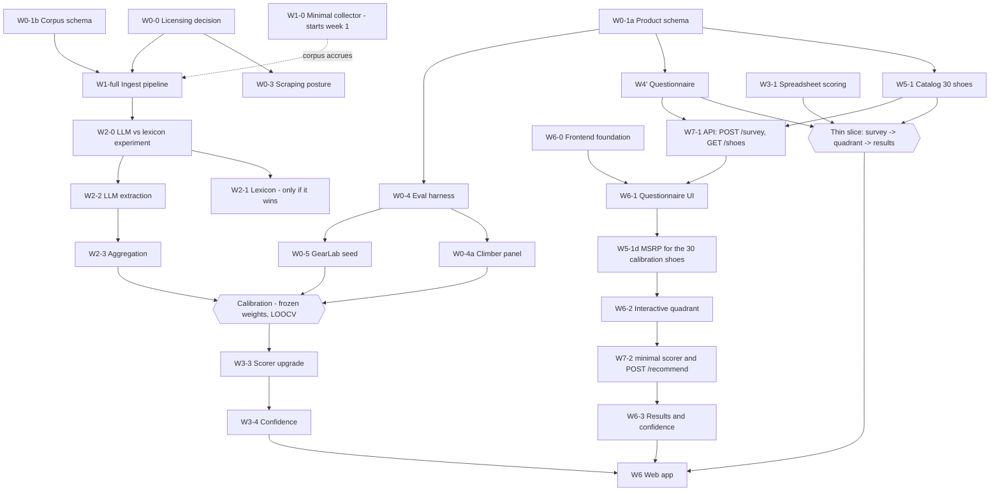
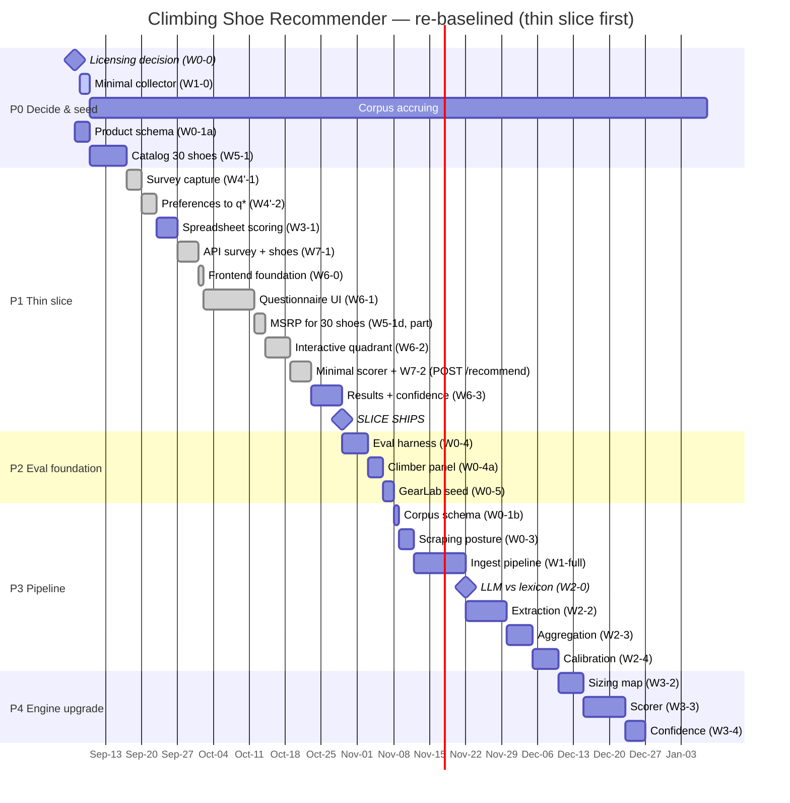

# Climbing Shoe Recommender — Project Plan & Agent Task Spec

**Version:** 3.6
**Status:** Active. Supersedes v2.0 (2026-05-25).
**Last updated:** 2026-11-06
**Change basis:** v3.0 was the feasibility review of all 22 backlog tasks (§2.1). v3.1 adds D11 and D12, records what has actually been built (§2.0), and folds in two findings measured from the first live collection run — the mention-attribution problem (W1-3) and the $N_{\min}$ reachability problem (W2-3). **v3.2** closes a structural gap found while sequencing W6-1: the HTTP layer (**W7**) and the frontend build foundation (**W6-0**) were assumed by the scaffold but carried no task ID, so the plan showed W6-1 as startable when two prerequisites did not exist. **v3.3** records W6-1 as done and closes the §13 $\mathbf{q}^*$ wiring gap (option a, implemented in `store.build_survey_row`). It also decides the W6-3 scorer gap: a minimal coded scorer and W7-2 move into the thin slice, and the 30 calibration shoes get MSRP first. **v3.4** records that MSRP sourcing is partial: 23 of 30 calibration shoes are priced, 7 are null, and W5-1d stays open. **v3.5** records W6-2 as done: `GET /quadrant`, `/api/quadrant` and the `/quadrant` page with its interactive chart and table. It also records that `is_anchor` is derived from `validate.ANCHORS` rather than stored (§13). **v3.6** records W7-2 as done: a minimal v0-slice scorer, `POST /recommend` and persona fixtures, verified against PostgreSQL 16.15. It also resolves the DB-backed test gap recorded for W6-1 and W6-2. The minimal scorer is not the full W3-3, which stays open. See §15.
**Progress:** 11 of 37 tasks complete (4 deferred: W0-3, W0-1b, W2-5, W5-2). W1-0b is **not** complete: its collection path failed the YouTube terms review (§10.2). **W5-1d is partial** (23 of 30 calibration shoes priced, 2026-11-05) and is not counted. See §2.0.

---

## 0. How To Use This Document (read first, agent)

This is the single source of truth for the project. It encodes:

- Resolved product decisions (§2 Decision Log) — **do not re-litigate** without user sign-off.
- Workstreams, the recommendation math, the data model, the eval strategy, and a task backlog with stable IDs (§5–§11).

Operating rules for the agent working this project:

- Act as a rigorous, honest technical mentor. No sycophancy. Challenge flawed assumptions; explain *why* and propose a better alternative.
- The user has climbing domain expertise. Trust shoe-specific corrections (they were right on the Drago classification and on "sensitive on rock" = soft).
- Prioritize accuracy over agreement. Cite sources. Provide documentation-quality notes on technical decisions.
- **Ship a thin product slice before the pipeline.** This reverses v2's "validate the pipeline before building product surface." See D7 — the reversal is deliberate and reasoned, not drift.

---

## 1. Product Overview

A web application that **recommends climbing shoes** matched to a user on three independent dimensions:

1. **Fit** — does the shoe physically suit the user's foot?
2. **Style/performance** — does the shoe's character match the user's discipline, terrain, and preference?
3. **Budget** — is it within price/availability constraints?

The original availability-based recommendation angle was **dropped**. The engine is powered by a **domain-specific LLM extraction pipeline** that mines community discussion to characterize each shoe along a 2-axis performance quadrant, **calibrated** against expert review data (GearLab).

**MVP input method: a questionnaire** (see §2, D3). The LiDAR/photo foot scan is deferred to a later phase.

**Terminology note.** This is *not* a RAG system, and the term should not be used for it. Nothing is retrieved at query time; there is no vector store anywhere in §8. The design is **batch LLM extraction feeding an offline aggregate**. That is the correct architecture here — recommendations must be reproducible and fast, and an LLM in the request path would make them neither.

---

## 2. Decision Log (RESOLVED — binding)

| # | Decision | Rationale | Cascades |
|---|---|---|---|
| D1 | **LLM-extraction-first** for the NLP layer. No model training from scratch at MVP. | Zero labeled data exists. Training before labels is backwards. Distill to a small classifier only *after* LLM-bootstrapped labels accrue and cost justifies it. | `trainer.py` is **deferred** (W2-5). `NLP.py` becomes an LLM-extraction module. |
| D2 | **GearLab is calibration-only.** It grounds/anchors the labeling of the corpus and validates quadrant placement. It is **not** a live recommendation input and is **not** surfaced in product. | GearLab is a single expert source with structured scores — ideal ground truth, wrong as a social signal. Also ToS/copyright risk if redistributed. | Drives eval design (§9) and the GearLab→(x,y) mapping. |
| D3 | **Foot scan deferred. MVP uses a questionnaire** to gather fit + preference inputs and produce recommendations. | Scan is high-value but high-effort. Questionnaire ships the loop now and de-risks the engine first. | Rewrites the **Fit** term (§7) to survey-derived. W4 (scan) → W4' (survey). W6 capture UI → questionnaire UI. |
| D4 | **No image storage. Store derived measurements only.** Scan + biometric storage is a future update. | Avoids biometric/privacy legal exposure (BIPA/GDPR) at MVP. | W0-2 **dropped from MVP scope**; revisit when scan returns. Survey still carries standard PII handling. |
| **D5** | **Reddit commercial access is decided before any W1 code is written.** | v2 deferred this to "before launch," which means building the whole ingest and *then* learning the data is unusable. Free tier is non-commercial; the product is commercial. ~~standard tier starts ~$12k/yr~~ — **that figure was wrong; see D11.** | New task **W0-0**, first in P0 — **resolved 2026-09-13**. Gates W0-3 and all of W1-full. |
| ~~D6~~ | ~~Catalog seeds at 25–30 shoes, not 50–100.~~ | **SUPERSEDED by D12 (2026-09-13).** The reasoning conflated corpus coverage with catalog size. Kept here so the error stays auditable rather than silently rewritten. | — |
| **D12** | **Catalog targets ~100 shoes. The 30 hand-placed shoes become the calibration set for a spec-derived prior function, not the catalog itself.** | D6 was wrong. Fit (§7.2) and Budget (§7.6) never touch the corpus, so trimming the catalog degraded them for no NLP-related reason — and §7.7 confidence already exists to make prior-derived placements honest. Measured on the 30-shoe catalog: a typical user saw **3–4 candidates** after the size and budget gates; one with an uncommon size or tight budget saw **fewer than two**. The real constraint was that hand-placing needs a *judgement call* per shoe — which a spec→prior model removes at **LOOCV MAE x 0.139 / y 0.113, 87% quadrant agreement**, better than the ≤0.2 §9.2 demands of the NLP pipeline itself. | W5-1 re-expanded to ~100. New `priors.py`. Adds `prior_source` provenance (corpus > hand > spec) feeding §7.7. MSRP sourcing now scales with catalog size and becomes the real budget item. |
| **D7** | **A thin product slice ships before the NLP pipeline.** 30 hand-placed shoes, survey, quadrant, ranked results, no NLP. | v2's ordering assumed the pipeline was the risky part. It isn't — batch extraction is routine. The real risks are legal source access and whether anyone wants this. Pipeline-first defers both by months. | **Reverses §0 of v2.** Restructures §12 entirely. W6-2 moves into P0/P1. |
| **D8** | **Calibration weights are frozen before measurement, and evaluation uses LOOCV, not a holdout split.** | v2 was circular: §9.1 tuned the GearLab mapping to hit the confirmed placements, then §9.2 graded NLP against that fitted mapping. And an 80/20 split of n≈20 leaves 4 test shoes — CI on 4-sample accuracy is ~±45pp. | Rewrites §9. Adds the climber panel (W0-4a) as a second ground-truth source. |
| **D9** | **Sizing is a soft warning, not a hard gate** — except where the brand does not make the size at all. | Downsizing convention is contested and personal. A hard gate over noisy self-reported sizing silently drops shoes that would have fit. | Rewrites §7.6. W3-2 rescoped. |
| **D10** | **Survey fit validation is a directional check (n≈8–12), not a statistical study.** | A real claim needs 30–50 participants and weeks of recruitment. Solo and pre-launch, that is not available. | W4'-3 rescoped. Real validation waits for §9.3 post-launch data — which is why the feedback columns land in W0-1a now. |
| **D11** | **Reddit is not load-bearing. Apply for free non-commercial access now; build the corpus on YouTube and forums.** | Self-service app registration is closed — every OAuth client needs manual approval, reported at 2-4 weeks with a real chance of silent rejection. Cost turned out not to be the obstacle (metered access is about $3.60 at this volume); *access latency and uncertainty* are. | Resolves W0-0. Splits W1-0 into 0a (apply), 0b (YouTube/forums collector), 0c (Reddit adapter on approval). Forces a source-agnostic collector interface. See §10.0. **REOPENED 2026-09-16 — needs user sign-off.** The YouTube half of this decision failed the terms review (§10.2): the Developer Policies appear to prohibit the §7.4 design outright. The Reddit half stands. |

### 2.0 Progress (audited 2026-09-14; refreshed 2026-11-06)

Audited against files on disk and verified runs, not against memory.

**Complete — 11 of 37 backlog tasks** (37 since v3.2 added W6-0, W7-1, W7-2):

| Task | Evidence |
|---|---|
| W0-0 licensing decision | D11 + §10.0. Two v3 assumptions corrected. |
| W0-1a product schema | `0001_init.sql`. Applies / reverses / re-applies clean on PG 16.15; 10 constraint probes pass. |
| W5-1a hand-place 30 shoes | `shoes.yaml`, seeded to Postgres: 30 shoes, 71 aliases. |
| W5-1b spec→prior model | `priors.py`. LOOCV MAE x 0.139 / y 0.113, 87% quadrant agreement. |
| W4'-1 survey capture (2026-09-17) | `survey/{schema,anchors,store}.py`. 146 tests; anchors resolve against the seeded catalog and reject unknown *and ambiguous* pairs; no DDL added. Reviewed 2026-09-20 (database / python / security). |
| W4'-2 preferences → $\mathbf{q}^*$ (2026-09-23) | `survey/preferences.py`, a pure stdlib function. Every discipline lands in its §3 quadrant, and $\mathbf{q}^*$ stays inside $[-1,1]^2$ and off both axes for all 600 enum combinations (1334 tests). Reviewed (python). **Wired into capture by W6-1** (2026-11-05) — see §13. |
| W7-1 API: `POST /survey` + `GET /shoes` (2026-09-25) | `main.py`, `api/deps.py`, `api/routes/{survey,shoes}.py`; 57 tests. `POST /survey` adds no validation of its own: its 422 list equals `build_survey_row()`'s, and a test pins that FastAPI validates nothing on the route. A valid submission returns only `survey_token`. `GET /shoes` returns `version`/`gender`, and every item round-trips to its own id. Reviewed (python, 2 rounds; security). **$\mathbf{q}^*$ wired by W6-1** (2026-11-05) — see §13. |
| W6-0 frontend foundation (2026-10-01) | `layout.tsx`, `page.tsx`, a committed `package-lock.json`, Vitest + React Testing Library, Playwright, and a CI `frontend` job. `npm run build` prerenders all four routes; 2 Vitest and 2 Playwright tests pass, the latter against both `next dev` and the production build; lint and type-check are clean. `next` was raised 16.2.4 → 16.3.8 to clear critical advisories (`npm audit`: 0). Reviewed (typescript). |
| W6-1 questionnaire (2026-11-05) | `survey/page.tsx` and `SurveyForm` (fit, preference, budget and anchor inputs); `AnchorPicker` over `GET /shoes`, disambiguating version and gender; `results/page.tsx` placeholder. q* is derived in `store.build_survey_row()` from a raw `goal`; caller-supplied targets are refused. Next.js route handlers `/api/survey` and `/api/shoes` proxy to FastAPI (allow-listed paths, 32 KB cap, masked errors, `CRUXUP_API_URL`); typed client `lib/api.ts`, payload converter, design tokens in `globals.css`. Tests: 190 Vitest, 8 Playwright against a stub FastAPI, 14 pytest contract tests; backend 1,639 passed and 15 DB-backed skipped (no Postgres at development time, §13). **Resolved 2026-11-06:** the 15 DB-backed tests were run against PostgreSQL 16.15 on this branch stack and pass. Reviewed (python, typescript, react, security). |
| W6-2 interactive quadrant (2026-11-06) | `GET /quadrant` (`routes/quadrant.py`, W6-2-A) serves every shoe with a prior. `is_anchor` comes from `validate.ANCHORS` (no DDL); `quadrant` comes from `priors.quadrant()`, so an on-axis prior is a masked 500, by design. `/api/quadrant` proxies it through the allow-list (W6-2-B). `getQuadrant()` has a runtime guard, pinned to the API by a contract test (W6-2-C). The hand-rolled SVG `QuadrantChart` (W6-2-D) draws the §3 axes with soft up, so Q1 sits bottom-right; provenance is shown by shape and fill; the five anchors are labelled; it has a roving tabindex, ≥24 px hit areas, plain-language accessible names and a tooltip. `QuadrantTable` is the non-visual alternative, and the `/quadrant` page is linked from home (W6-2-F). Phone-width fixes were found by rendering the page at 375 px and 1280 px (W6-2-F2, F3). Playwright journeys run against a stub backend (W6-2-G). Vitest 311 passed; Playwright 15 passed in dev and under `CI=1`; contract tests 17. Backend 1711 passed, 18 skipped without a database; the DB-backed quadrant tests have not run at the time (§13). **Resolved 2026-11-06:** the three were run against PostgreSQL 16.15 and pass. `next build`: `/quadrant` static (○), `/api/quadrant` dynamic (ƒ). Reviewed: python, database, typescript, react (incl. accessibility and dataviz). |
| W7-2 scorer and `POST /recommend` (2026-11-06) | Minimal v0-slice scorer in `backend/app/recommend/` (W7-2-A to D). `scorer_config.py` holds every output-affecting constant under `SCORER_VERSION` `v0-slice`, checked at import and pinned by a snapshot test. `style.py` is §7.3 and q* resolution. `fit.py` is §7.2: anchor families and a judgement Fit_cat table **pending climber sign-off**. `confidence.py` is §7.7, with a high/medium/low label. `score.py` is §7.6: the combined rank, the size and price gates, and an explicit null-MSRP branch. `POST /recommend` (`api/routes/recommend.py`, W7-2-E) takes a body of `{"survey_token"}`, validated before any database connection. An unknown token is a fixed 404. The survey row is locked `FOR UPDATE`. The write is an idempotent upsert on `(survey_id, shoe_id)` that preserves feedback, with one commit after the response is validated. Persona fixtures (`test_recommend_personas.py`) replace W3-1's spreadsheet sanity check. Verified 2026-11-06 against PostgreSQL 16.15: backend 2,001 passed, 0 skipped. That includes the 15 W6-1 and 3 W6-2 DB-backed tests and the new `/recommend` persistence tests. Without a database: 1,976 passed, 25 skipped. The Next.js proxy route for `/recommend` is not built (W6-3). Reviewed (python, silent-failure, fastapi incl. security, database). |
| W5-1d (part) MSRP for the 30 calibration shoes (2026-11-05) | **Partial, not counted in the 11.** `shoes.yaml`: 23 of 30 priced (19 from the brand's US site, 4 from a list price at least two retailers agree on); 7 null (Anasazi Pro, Mythos, Maestro Mid, Astroman, Katana Velcro, Elektra, Moccasym). `validate.py` warns 7/30; `validate.py --require-msrp` fails by design until those seven are resolved. `test_priors.py` pins `msrp_usd` to NUMERIC(7,2). Spot-checks outstanding (§13). |

**Built but not on the backlog** — support the above, worth naming so they are not re-scoped later:
`validate.py` (catalogue invariants + the `--require-msrp` budget-gate guard), `config.py` (`.env` loading), `SETUP.md` (local setup, verified end to end), 54 tests.

**Two measured findings that change downstream design:**

0. **The YouTube corpus is not cleared (§10.2).** YouTube's Developer Policies cap stored API data at 30 days and prohibit aggregating it or deriving new metrics from it — which is what §7.4 does. The 403 collected documents were purged on 2026-09-16 (they also carried reproducible author hashes). D11 is reopened. **This blocks the pipeline half of the plan; the thin slice (D7) does not depend on it.**
1. **W1-3 needs redesigning.** Only 18% of collected comments name a shoe; 44% say "these/them/it". Alias matching would capture under a fifth of the corpus. Attribute by video subject first.
2. **$N_{\min}=25$ may be unreachable.** 0/30 shoes clear it at 379 documents; top 5 hold 64% of mentions. The power law is steeper than §4 assumed. Query generation is currently anchor-biased, which partly explains it — per-shoe queries are the first fix.

**Not started:** everything else. The thin slice (D7) now has its data layer, survey capture, the $\mathbf{q}^*$ target function wired into capture, an HTTP surface for capture, the catalogue and the quadrant, a questionnaire UI with a browser-to-API path, the interactive quadrant at `/quadrant`, plus a results placeholder. It has a minimal v0-slice scorer and `POST /recommend` (W7-2), but no ranked results page (W6-3). `nlp/` and `eval/` are still stubs.

**Nearest unblocks (refreshed 2026-11-06):** W6-1, W6-2 and W7-2 are done. The thin slice follows the user-approved sequence and ends with **W6-3** results. W6-3 is the last thin-slice task, and the slice ships after it. The steps before it were **MSRP for the 30 calibration shoes** (W5-1d, part: 23 of 30 sourced 2026-11-05; the 7 nulls and the §13 spot-checks stay open) and the minimal coded scorer with W7-2 (pulled into the slice, §13 option a, decided 2026-11-05). W1-0a remains one hour of paperwork gating a 2–4 week queue. The rest of W5-1 (the catalogue expansion and the remaining MSRP) gates the §7.6 budget gate.

### 2.1 Review disposition (2026-09-07)

| Verdict | Count | Tasks |
|---|---|---|
| Keep as written | 9 | W0-0, W0-5, W2-2, W2-3, W3-1, W3-4, W4'-1, W4'-2, W6-1, W6-3 |
| Rework | 8 | W0-1, W0-4, W1-1/2/3, W2-1, W2-4, W3-2, W3-3, W6-2 |
| Cut / rescope | 2 | W5-1, W4'-3 |
| Defer | 3 | W0-3, W2-5, W5-2 |

W5-2 was omitted from the review sheet and is dispositioned **defer** by default — at a 30-shoe hand-curated catalog, a discontinued shoe is a manual edit, not a subsystem. Revisit when the catalog grows past ~50.

---

## 3. The Shoe Quadrant Framework (core product concept)

Shoes are positioned on a 2-axis plane. Coordinates normalized to $[-1, 1]$.

- **Horizontal $x$:** Comfort ($-1$) ↔ Performance ($+1$)
- **Vertical $y$:** Stiff ($-1$) ↔ Soft ($+1$)

| Quadrant | Position | Climbing context |
|---|---|---|
| Q1 | Performance + Stiff ($x>0, y<0$) | Sport, technical face, precision edging, board last |
| Q2 | Comfort + Stiff ($x<0, y<0$) | All-day trad, big wall, wide toe box, flat last, **multi-pitch** |
| Q3 | Comfort + Soft ($x<0, y>0$) | Gym, beginner, slabs, neutral shape, slip-on |
| Q4 | Performance + Soft ($x>0, y>0$) | Bouldering, steep terrain, aggressive downturn, soft rand |

**Confirmed placements (CORRECTED in v3 — do not regress):**

| Shoe | Quadrant | v2 said | Note |
|---|---|---|---|
| La Sportiva Solution | **Q1** | ~~Q4~~ | Performance + stiff. Downturned, but the P3 midsole makes it stiff for a boulder shoe. |
| La Sportiva TC Pro | **Q2** | Q2 | Comfort + stiff. Unchanged. |
| Scarpa Drago | **Q4** | ~~Q1~~ | Performance + soft. Soft, aggressive boulder shoe. |
| Scarpa Instinct VSR | **Q4** | ~~Q1~~ | Performance + soft, but **less soft than the Drago** — sits nearer the $y=0$ boundary. |
| Evolv Defy | **Q3** | ~~Q2~~ | Comfort + soft. Gym/beginner shoe. |

> **v2 defect, now fixed.** The v2 quadrant column contradicted §3's own axis definitions, its own per-shoe notes, and the list in §9.1 — on four of five rows. The notes and §9.1 agreed with each other, so they were the surviving reading. The Drago row was the sharpest case: it asserted "**Not Q4**" when Q4 is exactly what its own note ("performance + soft") describes. Because this table is calibration ground truth for §9.1's weight tuning, the inversion would have propagated into every downstream MAE. Fixed before W0-5 loads any labels.

---

## 4. Climbing Lexicon (proprietary asset — scope now conditional)

The lexicon maps **climbing-specific phrases to axis signals**, not generic polarity. Same word, different meaning in-context.

**Target revised: 60–80 patterns, not 200–300** — and the asset is now *conditional* on W2-0 (§11). Phrase frequency in review text is Zipfian: most matched signal comes from perhaps twenty patterns, and patterns 200–300 fire on almost nothing. Author 60–80, then measure the marginal contribution of the last twenty before writing more.

| Phrase | Axis signal |
|---|---|
| "sensitive on rock" / "feel the rock" | **Soft** ($+y$). Softness reduces dampening → more tactile feedback. **Not an independent quality.** |
| "precise on small edges" | Performance + stiff (Q1) |
| "supportive all day" | Stiff + comfort (Q2) |
| "smears well" | Soft ($+y$) |
| "feet were screaming after a pitch" / "toes aching after a day" | High performance, low comfort ($+x$, aggressive fit) |
| "wore these all day on a multipitch" / "perfect for multi-pitch" | Comfort + moderate stiffness (Q2). Confirmed by GearLab: flat-midsole comfort shines on multi-pitch. |
| "aggressive downturn" | Performance + soft (Q4) |

**Bias warning (carry into aggregation):** social data is popularity-weighted. Beginner/intermediate climbers dominate online. A shoe loved by elite climbers may score middling because most reviewers misuse it. **Weight opinions by stated experience level.**

---

## 5. Workstreams (scopes)

| ID | Workstream | Produces | MVP status |
|---|---|---|---|
| **W0** | Foundations / Eval | Licensing decision, data model, eval harness, GearLab seed labels | Active (this phase) |
| **W1** | Data & Scraping Infra | Minimal collector now; full ingest after D5 resolves | W1-0 active; W1-full gated |
| **W2** | NLP / Lexicon / Extraction | Lexicon, LLM extractor, aggregation → quadrant | After the thin slice |
| **W3** | Recommendation Engine | Fit + Style + Budget scoring, sizing map | Partly in thin slice: W3-1 persona fixtures replace the spreadsheet check; a minimal v0-slice scorer and survey/placement confidence are built (W7-2). W3-3 and W3-4 stay open |
| **W4'** | **Questionnaire** | Survey schema, intake UI, foot profile + target $q^*$ | In thin slice |
| **W5** | Catalog & Data Model | **25–30** seeded shoes, geometry/last specs, lifecycle | In thin slice (W5-1) |
| **W6** | Frontend / UX | Build foundation, questionnaire UI, interactive quadrant, results | **In thin slice** (moved from last) |
| **W7** | **API / Service layer** | FastAPI app; survey, catalog and recommend endpoints | **In thin slice** (W7-1 and W7-2 done; `POST /recommend` served, Next.js proxy for it is W6-3). Added v3.2 — was assumed by the scaffold but never scoped |

---

## 6. Dependency Graph



**Critical path to a shippable product:** W0-1a → W5-1 → W4' → **W7-1 → W6-0 → W6-1** → MSRP for the 30 calibration shoes (W5-1d) → W6-2 → W7-2 (minimal scorer) → W6-3 → W6. The NLP pipeline is an *upgrade path* for shoe placement, not a precondition for shipping.

**On the two nodes added in v3.2.** The browser cannot reach the survey layer without an HTTP surface, and the Next.js app cannot build without a root layout or run tests without a harness. Both were assumed by `scaffold.sh` — which created `backend/app/main.py`, the three route stubs and `src/app/lib/api.ts` — but neither ever carried a task ID, so the plan showed W6-1 as startable when it was not. **Architecture decided 2026-09-21:** the browser calls Next.js route handlers, which forward server-side to FastAPI on localhost. That keeps every validation rule in the tested Python layer (W4'-1), needs no CORS, and never exposes the backend origin.

**Critical path to an NLP-backed product:** W0-0 → W1-full → W2-0 → W2-2 → W2-3 → CAL → W3-3.

---

## 7. Recommendation Math (v0 — survey edition)

### 7.1 Inputs

- **Survey foot profile** $\hat{\mathbf{f}}$: categorical self-reports — width $W$, instep/volume $V$, toe shape $T \in \{\text{Egyptian, Greek, Roman}\}$, arch $A$, heel size $H$.
- **Anchor sets:** $G$ = shoes the user reports fit *well* (brand + model + size); $B$ = shoes that fit *poorly*. **Highest-signal fit input** — lower noise than abstract self-report. Consider shipping fit v0 on anchors alone; every question removed from a questionnaire raises completion.
- **Shoe last profile** $\mathbf{s}_{\text{last},j}$ from catalog (last shape, volume, toe-box geometry, gender).
- **Shoe quadrant** $\mathbf{q}_j = (x_j, y_j)$ — hand-placed in the thin slice, NLP-derived after §7.4 lands.
- **User target** $\mathbf{q}^*$ from preference questions (§7.5).
- **Budget cap**, **size constraint**.

### 7.2 Fit score (survey-derived)

$$\text{Fit}_j = \lambda\,\text{Fit}^{\text{anchor}}_j + (1-\lambda)\,\text{Fit}^{\text{cat}}_j$$

- $\text{Fit}^{\text{cat}}_j$ — categorical match between $\hat{\mathbf{f}}$ and $\mathbf{s}_{\text{last},j}$.
- $\text{Fit}^{\text{anchor}}_j$ — similarity of shoe $j$'s last family to last families in $G$ (boost) and $B$ (penalty). Stronger, lower-noise.
- $\lambda \in [0,1]$ weights toward the anchor signal when $G \cup B \neq \varnothing$. **Set by judgment, not tuned** (D8 rationale; see §7.6).

A global survey-fit confidence $c_{\text{survey}}$ discounts $\text{Fit}_j$. **Forward-compatibility:** when scan returns, it raises $c$ and adds true geometric dimensions without changing this structure.

### 7.3 Style score (quadrant proximity)

$$\text{Style}_j = 1 - \frac{\lVert \mathbf{q}_j - \mathbf{q}^* \rVert_2}{2\sqrt{2}}, \qquad \mathbf{q} \in [-1,1]^2$$

### 7.4 NLP axis aggregation (per shoe, per axis; $x$ shown)

$$x_j = \frac{\sum_{m=1}^{N_j} e_m\, r_m\, a_m}{\sum_{m=1}^{N_j} e_m\, r_m}, \qquad N_j \ge N_{\min}$$

- $e_m$ = author-experience weight (mitigates popularity bias, §4).
- $r_m$ = recency decay.
- $a_m \in [-1,1]$ = phrase axis signal.
- $N_j < N_{\min}$ → spec-derived fallback placement + **low-confidence flag**.

**$N_{\min}$ must be assigned a value** — it was unspecified in v2 and is the most consequential free number in the plan, because it decides what fraction of the catalog carries real signal. Start at $N_{\min} = 25$ and publish the sensitivity curve (catalog coverage vs $N_{\min}$) as a W2-3 deliverable.

### 7.5 Target from questionnaire

$\mathbf{q}^*$ is derived from preference answers: discipline (boulder/sport/trad/gym), terrain (slab/vertical/overhang/crack), experience level, comfort-vs-performance goal, stiffness preference, downsizing/pain tolerance. Assert that each of the four disciplines lands in the quadrant §3 associates with it.

### 7.6 Combined rank (soft terms, one hard gate)

$$\text{Score}_j = \big(\alpha\,\text{Fit}_j + \beta\,\text{Style}_j + \gamma\,\text{Budget}_j\big)\cdot \mathbb{1}[\text{size exists}]\cdot \mathbb{1}[\text{price} \le \text{cap}]$$

with $\alpha + \beta + \gamma = 1$.

**Two changes from v2:**

1. **Sizing is no longer a hard gate on fit** (D9). The only hard size gate is $\mathbb{1}[\text{size exists}]$ — the brand does not make that size at all. Downsizing mismatch becomes a **ranked warning** the user can relax ("runs small, most climbers size up half"), which is also better product copy than an empty result set.
2. **$\alpha, \beta, \gamma, \lambda$ are set by judgment and documented, not tuned.** Tuning requires user-to-good-shoe pairs, which do not exist and cannot come from GearLab — GearLab grades shoes, not matches. Counting $\kappa$ and the $w$ terms, v2 proposed 7+ free parameters against ~20 data points. Externalize the weights to config; defer tuning to post-launch §9.3 data.

### 7.7 Recommendation confidence (surface to user)

$$C_j = g\big(c_{\text{survey}},\, N_j,\, \text{agreement}_j\big)$$

where $\text{agreement}_j$ = inverse variance of $a_m$. Low corpus volume or split opinion → low $C_j$, displayed honestly.

**Promoted to first-class (W3-4).** With most of the catalog served by spec priors rather than corpus signal, this is not a finishing touch — it is the mechanism that makes shipping a thin corpus honest rather than misleading. A recommendation derived from four mentions and one derived from eighty must not arrive looking identical, and the flag must survive from aggregation through to the rendered card.

---

## 8. Data Model (W0-1)

Postgres via Supabase. **Split into two migrations** (D5 cascade): the product schema ships now; the corpus schema waits until the source question resolves.

**On Supabase specifically:** keep it, but recognize you are using it as managed Postgres — there is no auth in the MVP, no realtime, no storage (D4 forbids it). Talk to it through `psycopg` rather than the `supabase` client so the decision stays reversible.

### 8.1 W0-1a — Product schema (build now)

```sql
CREATE TABLE shoe (
  id              UUID PRIMARY KEY DEFAULT gen_random_uuid(),
  brand           TEXT NOT NULL,
  model           TEXT NOT NULL,
  version         TEXT,
  gender          TEXT,
  last_shape      TEXT,
  downturn        TEXT,
  stiffness_spec  TEXT,
  closure         TEXT,
  rubber          TEXT,
  msrp_usd        NUMERIC,
  status          TEXT DEFAULT 'active',
  quadrant_x_prior NUMERIC,            -- hand-placed in the thin slice
  quadrant_y_prior NUMERIC,
  UNIQUE (brand, model, version, gender)
);

CREATE TABLE shoe_alias (
  shoe_id UUID REFERENCES shoe(id),
  alias   TEXT NOT NULL,
  PRIMARY KEY (shoe_id, alias)
);

CREATE TABLE shoe_size_map (
  shoe_id          UUID REFERENCES shoe(id),
  brand_size       TEXT,
  us_street_equiv  NUMERIC,
  downsize_note    TEXT,
  size_exists      BOOLEAN DEFAULT TRUE,  -- the ONLY hard gate (D9)
  PRIMARY KEY (shoe_id, brand_size)
);

CREATE TABLE user_survey (
  id              UUID PRIMARY KEY DEFAULT gen_random_uuid(),
  survey_token    TEXT UNIQUE NOT NULL,   -- anonymous; links follow-up to recommendation
  foot_width      TEXT,
  instep          TEXT,
  toe_shape       TEXT,
  arch            TEXT,
  heel_fit        TEXT,
  street_size     NUMERIC,
  known_good_shoes JSONB,                 -- anchor set G [{brand,model,size}]
  known_bad_shoes  JSONB,                 -- anchor set B
  discipline      TEXT,
  terrain         TEXT,
  level           TEXT,
  goal_x_target   NUMERIC,
  goal_y_target   NUMERIC,
  budget_cap_usd  NUMERIC,
  created_at      TIMESTAMPTZ DEFAULT now()
);

CREATE TABLE recommendation (
  id          UUID PRIMARY KEY DEFAULT gen_random_uuid(),
  survey_id   UUID REFERENCES user_survey(id),
  shoe_id     UUID REFERENCES shoe(id),
  fit_score   NUMERIC,
  style_score NUMERIC,
  total_score NUMERIC,
  confidence  NUMERIC,
  rank        INT,
  -- §9.3 online metrics. Absent in v2; without these the eval loop is unclosable.
  accepted        BOOLEAN,
  satisfaction    NUMERIC,
  returned        BOOLEAN,
  feedback_at     TIMESTAMPTZ
);
```

> **v2 defect, now fixed.** v2's `recommendation` had nowhere to record acceptance, satisfaction or regret, and `user_survey` carried no token to link a follow-up back to what was recommended — yet §9.3 asks for exactly those metrics. Adding the columns later is cheap; adding them after users have already been through the funnel loses that cohort permanently.

### 8.2 W0-1b — Corpus schema (build after W0-0)

```sql
CREATE TABLE gearlab_label (
  shoe_id       UUID REFERENCES shoe(id),
  metric        TEXT,                  -- comfort, edging, smearing, pulling, sensitivity, crack
  score         NUMERIC,               -- normalized 0..1
  source_url    TEXT,
  snapshot_date DATE,
  PRIMARY KEY (shoe_id, metric, snapshot_date)
);

CREATE TABLE corpus_snapshot (
  id          UUID PRIMARY KEY DEFAULT gen_random_uuid(),
  source      TEXT,
  scraped_at  TIMESTAMPTZ,
  version     TEXT
);

CREATE TABLE mention (
  id           UUID PRIMARY KEY DEFAULT gen_random_uuid(),
  snapshot_id  UUID REFERENCES corpus_snapshot(id),
  shoe_id      UUID REFERENCES shoe(id),
  source       TEXT,
  author_hash  TEXT,                   -- hashed, no raw PII
  body         TEXT,
  permalink    TEXT,
  created_utc  TIMESTAMPTZ
);

CREATE TABLE extraction (
  mention_id    UUID REFERENCES mention(id),
  attribute     TEXT,
  axis          TEXT,
  signal_value  NUMERIC,
  archetype     TEXT,
  experience    TEXT,
  confidence    NUMERIC,
  lexicon_version TEXT
);

CREATE TABLE shoe_axis_score (
  shoe_id        UUID REFERENCES shoe(id),
  axis           TEXT,
  value          NUMERIC,
  n_mentions     INT,
  agreement      NUMERIC,
  confidence     NUMERIC,
  computed_at    TIMESTAMPTZ,
  lexicon_version TEXT,
  PRIMARY KEY (shoe_id, axis, computed_at)
);

CREATE TABLE lexicon (
  id       UUID PRIMARY KEY DEFAULT gen_random_uuid(),
  pattern  TEXT,
  axis     TEXT,
  polarity NUMERIC,
  version  TEXT
);
```

**Versioning principle:** corpus snapshots, lexicon, and axis scores are all versioned so any quadrant placement is reproducible.

---

## 9. Eval Strategy (W0-4)

Without eval, the recommender is unfalsifiable. Define metrics **before** building W2/W3.

### 9.1 GearLab → (x, y) mapping (calibration target)

Normalize each GearLab metric to $[0,1]$: Comfort $C$, Edging $E$, Smearing $Sm$, Pulling/Steep $P$, Sensitivity $Se$.

$$x^{\text{GL}} = \tanh\!\big(\kappa\,[\,w_E E + w_P P - w_C C\,]\big) \quad (\text{+1} = \text{performance})$$

$$y^{\text{GL}} = \tanh\!\big(\kappa\,[\,w_{Sm} Sm + w_{Se} Se - w_E E\,]\big) \quad (\text{+1} = \text{soft})$$

**Axis independence must be checked before this formula is committed.** $E$ appears in both expressions with opposite signs, which correlates $x$ and $y$ by construction — contradicting §3's claim that these are two independent dimensions. Verify that Solution (Q1) and Drago (Q4) actually resolve apart under it. If they do not, drop $E$ from the $y$ expression and re-derive.

**Frozen-weight protocol (D8).** Fit $\kappa$ and the $w$ terms using domain reasoning plus the five §3 anchors **only**. Write the resulting values into this document. Then never touch them again. Every remaining GearLab shoe is an untouched test set.

Sign note: **sensitivity → soft** (consistent with "sensitive on rock" = soft).

### 9.2 Offline metrics (pipeline correctness)

- **Axis MAE:** $\text{MAE}_x = \frac{1}{n}\sum_j |x_j^{\text{NLP}} - x_j^{\text{GL}}|$, same for $y$.
- **Quadrant agreement:** % of overlapping shoes placed in the same quadrant, reported as a 4×4 confusion matrix **with its sample size stated**.

**Resampling: leave-one-out cross-validation, not an 80/20 split.** The calibration set is the GearLab overlap — roughly 17–27 shoes. An 80/20 split leaves 4 test shoes; the confidence interval on 4-sample accuracy is about ±45 points, which cannot pass or fail anything. LOOCV gives ~20 folds instead of 4 test points and is the right tool at this $n$.

**State the pass threshold before the run, not after seeing the number.**

### 9.3 The agreement ceiling (W0-4a — new)

Have **two or three climbers independently place 40–60 shoes** on the quadrant. This produces:

- A second ground-truth source that is not GearLab, breaking the single-source dependency.
- **An inter-rater agreement ceiling.** Without it there is no way to know what MAE is even achievable — if two expert climbers disagree by 0.25 on average, an NLP MAE of 0.2 is at the noise floor and a threshold of 0.2 is meaningless.

This is the highest-value missing piece in v2's eval design and it costs a few hours of three people's time.

### 9.4 Online metrics (recommendation quality — post-launch)

- Recommendation acceptance rate.
- Self-reported fit satisfaction (post-purchase survey).
- Return/regret rate.
- Ranking quality (nDCG) once feedback labels exist.

These are the only route to tuning $\alpha, \beta, \gamma, \lambda$ (§7.6), which is why `recommendation` carries the feedback columns from day one.

---

## 10. Scraping Posture (W0-3) — gated by W0-0

### 10.0 W0-0 DECISION (resolved 2026-09-13)

**Decision (CONFIRMED 2026-09-13): free non-commercial Reddit access only. YouTube and climbing forums are the corpus. No advertising on the platform. Do not plan around Reddit being available.**

Three calls, settled and binding:

1. **Free non-commercial tier only.** No paid Reddit agreement will be pursued. Apply for free access; if it is refused, the project proceeds without Reddit.
2. **YouTube + forums are the primary corpus**, not a fallback.
3. **No ads on this platform.** Settles the advertising restriction — it cannot be breached by a product that carries no advertising.

**The consequence to keep visible.** Free-tier access is *non-commercial*, and that is a property of the product, not of the API key. No ads is one half of staying inside it; the other half is that **affiliate links on shoe recommendations would very likely count as commercial use**, and that is the obvious way a shoe recommender earns money. So this decision is not merely "no ads" — it is a commitment to run non-commercially for as long as Reddit data is in the corpus. If a revenue model ever appears, the choice is to strip Reddit-derived signal or to re-license. Keeping Reddit non-load-bearing (point 2) is what keeps that exit cheap.

**The risk moved, it did not vanish.** YouTube and the forums are now primary, so *their* terms are now the governing ones. Before W1-0b collects anything: check YouTube's API terms for the same commercial-use question, and check `robots.txt` plus terms for Mountain Project and UKClimbing. This is a smaller surface than Reddit's, not a zero one.

### 10.2 YouTube terms review (2026-09-16) — outcome: NOT CLEARED

§10.0 required checking YouTube's terms before W1-0b collected anything. That check was skipped: 403 documents were collected on 2026-09-14 before it happened. It is recorded here now, against the collection path actually built — **YouTube Data API v3, `search.list` plus `commentThreads.list`, public comments fetched with an API key.** `youtube-transcript-api` is not implemented and was not reviewed.

Source: YouTube API Services Developer Policies, <https://developers.google.com/youtube/terms/developer-policies>, read 2026-09-16. Quoted:

| § | Policy text | Conflict with this project |
|---|---|---|
| III.E.4.d | API clients "may temporarily store limited amounts of [Non-Authorized Data] … but not longer than 30 calendar days." | Public comments fetched with an API key are Non-Authorized Data. The landing store was built to keep raw data **indefinitely**. |
| III.E.4.h | API clients "must not … access or use [API Data] to create new or derived data or metrics." | §7.4 exists to derive per-shoe axis scores. This is the core of the pipeline. |
| III.E.2.a | "Do not aggregate [API Data] except … relating to YouTube channels that are under the same content owner." | §7.4 aggregates comments across many unrelated channels. |
| III.G.1.d | No selling advertising on pages containing API data without independent value. | Not a conflict: the platform carries no advertising (D11). |
| III.F.2.a | Pages displaying YouTube content must attribute YouTube. | Not a conflict today: nothing displays YouTube content. |

**Outcome: the YouTube collection path is not cleared for the §7.4 design.** Under III.E.4.h and III.E.2.a the intended *use* looks prohibited, not merely constrained. Retention limits and attribution could be engineered around; derived-metrics and aggregation bans cannot, without abandoning what the corpus is for.

**Actions taken:**

- The 403 collected documents were purged. The terms give no permitted purpose for them in this design, and every row also carried an author hash reproducible from the public fallback salt.
- W1-0b is no longer counted complete. The collector code and tests stay, because the source-agnostic interface still serves forums and Reddit.
- D11 is reopened rather than rewritten. It is a binding decision and changing it needs user sign-off.

**Caveats — read before re-deciding:**

- This is a reading of the published policy text, not legal advice. The derived-metrics prohibition is broad enough that its application to aggregate text analysis should be confirmed, ideally through YouTube's API compliance process rather than assumed either way.
- If YouTube is kept in any form, a 30-day retention purge (III.E.4.d) is mandatory, and "keep raw forever because re-collection is impossible" must be dropped from the collector's design.
- The same review has **not** been done for Mountain Project or UKClimbing (W1-0b′), or for Reddit's developer terms beyond commercial use. With YouTube out, those become the primary corpus candidates and inherit this exact question. Review them before building the forum adapter.

**Options for re-deciding D11** — for the user, not decided here:

1. **Forums as primary.** Review their terms first, as above.
2. **Reddit as primary.** The free non-commercial tier is still pending application (W1-0a). Reddit's Data API terms need the same derived-use review.
3. **No scraped corpus for MVP.** Ship on hand and spec priors (D12, `priors.py` at LOOCV MAE 0.139/0.113), with the climber panel (W0-4a) as the only human signal. The thin slice (D7) already works this way, and the first real measurement showed N_min=25 unreachable anyway.
4. **Pursue YouTube compliance** through Google's audit process — slow and uncertain.


**What changed the answer.** Two findings contradict what v3 assumed on 2026-09-07:

| | v3 assumed | Reported reality (Sep 2026) |
|---|---|---|
| Bundled commercial tier | ~$12,000 **per year** | ~$12,000 **per month** for ~50M calls — about 12x worse |
| Metered commercial rate | $0.24 / 1k calls | Unchanged — at ~15k calls that is **about $3.60** |
| App registration | self-service, start any time | **Closed.** Manual approval for every new OAuth client, free or paid |
| Approval latency | not considered | **2-4 weeks reported, with a real chance of silent rejection** |
| Commercial path | "budget it before launch" | Separate written approval via a sales process, not the developer queue |
| Advertising | not considered | Cannot display Reddit content alongside advertisements |

**Cost was never the obstacle.** At this project's volume the metered rate is trivial. The obstacle is **access latency and uncertainty**: you cannot start collecting on demand, and you may be refused with no recourse.

**Therefore:**

1. **Submit the free non-commercial application now.** It costs nothing, and the 2-4 week queue is the long pole — every day it is not submitted is a day added to the end. Non-commercial is the honest classification today: there is no product, no revenue, no launch date.
2. **Do not make Reddit load-bearing.** YouTube transcripts plus climbing forums (Mountain Project, UKClimbing) become the primary corpus. If Reddit approval lands, it is an upgrade.
3. **Defer the commercial conversation** until there is a launch date or revenue. Re-open it then — and budget the *metered* rate, not the bundled tier, unless volume genuinely reaches tens of millions of calls.
4. **Flag for the monetization plan:** the advertising restriction needs checking before any ad-supported revenue model is designed around Reddit-derived content. Affiliate links on shoe recommendations may or may not fall inside it.

> **Source quality caveat.** Reddit publishes no official commercial rate card. The pricing and latency figures above come from third-party 2026 reports, corroborated across several but not verified against Reddit directly. The *policy* points — non-commercial-only free tier, mandatory approval, written approval for commercial use, the advertising restriction — trace to Reddit's own Developer Platform documentation and Responsible Builder Policy. Re-verify pricing at the point a commercial application is actually made.

### 10.1 Source table

| Source | Access path | Limit / cost | Commercial allowed? | Action |
|---|---|---|---|---|
| **Reddit** | PRAW + OAuth 2.0, **approval required** | ~60 QPM practical via PRAW (100 QPM official cap) | **No** — free tier is non-commercial only; commercial needs written approval | **Apply now, plan without it** (§10.0). Pushshift is dead → no historical bulk; collect forward + cache. |
| **YouTube** | Data API v3 | 10k units/day default quota | Metadata yes; captions are harder than v2 implied | **Official captions require the video owner's OAuth**, so third-party captions are effectively unavailable through the sanctioned route. The practical path (`youtube-transcript-api`) is the unofficial one. Treat this as a weaker fallback than v2 assumed. |
| **GearLab** | **Manual transcription** | n/a | Internal calibration only (D2) | At 17–27 shoes this is manual-entry scale, not scraping scale. Transcribe by hand — faster than writing a scraper at $n=27$ and removes a legal surface entirely. |

**Implementation (when unblocked):** token-bucket rate limiter (sliding window), exponential backoff on 429, aggressive local caching. Hash author IDs; store no raw PII. The PII hashing and caching are worth keeping regardless of which source survives; the Reddit-specific quota logic is not.

**W1-0, corrected (2026-09-13).** v3 said "a crude collector running today beats a well-built one starting in eight weeks," and scheduled W1-0 for week 1. **That premise was wrong** — it assumed self-service app registration, which no longer exists. You cannot start collecting Reddit on demand; the clock starts when approval lands, 2-4 weeks out at best.

The underlying logic still holds — Pushshift is dead, so the corpus only grows **forward in wall-clock time** and every idle day is unrecoverable. What changes is *what you can do about it*:

- **W1-0a (today, ~1 hour):** submit the Reddit access application. This is the item on the critical path, and it is paperwork, not code.
- **W1-0b (today, ~2 days):** build the collector against **YouTube and forums**, which need no approval queue. This is where the corpus actually starts accruing this week.
- **W1-0c (on approval):** add the Reddit source behind the same interface. If approval never comes, nothing downstream breaks.

The collector must therefore be written source-agnostic from the first commit — a source registry with pluggable adapters, not a Reddit client with a thin wrapper.

---

## 11. Task Backlog (stable IDs; status: TODO unless noted)

### W0 — Foundations
| ID | Task | Deps | Effort | Notes |
|---|---|---|---|---|
| ~~W0-0~~ | ~~Reddit licensing decision~~ | — | 0.5d | **DONE 2026-09-13.** Resolved as D11/§10.0: free non-commercial only, YouTube+forums as corpus, no ads. Research corrected two v3 assumptions — bundled tier is ~$12k/**month** not /year, and self-service registration is closed (2–4 week manual approval). |
| ~~W0-1a~~ | ~~Product schema (§8.1)~~ | — | 2–3d | **DONE 2026-09-13.** `0001_init.sql` + `0001_init_down.sql`. Verified on PostgreSQL 16.15: applies clean, reverses to 0 tables, re-applies. 10 probes confirm constraints reject bad data. Includes §9.3 feedback columns, anonymous `survey_token`, and `scorer_version`. |
| **W0-1b** | Corpus schema (§8.2) | W0-0 | 1d | Deferred until the source is known. |
| W0-3 | Scraping posture + rate-limiter (§10) | W0-0 | 2–3d | **Deferred.** Size it to whichever source survives. |
| **W0-4** | Eval harness + metrics + GearLab map (§9) | W0-1a | 1w | **Rework.** Check axis independence first; LOOCV not a split; freeze weights before measuring. |
| **W0-4a** | **Climber panel: 2–3 raters place 40–60 shoes** | W5-1a | 3d | **NEW.** Second ground-truth source + inter-rater agreement ceiling. |
| W0-5 | GearLab seed: load labels + convert to (x,y) + seed phrases | W0-1b, W0-4 | 2d | **Manual transcription.** Blocked on the §3 correction — now applied. |

### W1 — Scraping
| ID | Task | Deps | Effort | Notes |
|---|---|---|---|---|
| **W1-0a** | **Submit Reddit free non-commercial application** | W0-0 | 1h | **NOT STARTED.** Paperwork, not code — and it is on the critical path: the 2–4 week approval queue only starts when it is submitted. Nothing downstream depends on it (D11), but every day unsubmitted is a day added to W1-0c. |
| **W1-0b** | Source-agnostic collector + YouTube adapter | — | 2d then passive | **CODE DONE, CORPUS NOT CLEARED (2026-09-16).** `collector.py` and 25 tests exist. The YouTube collection path failed the terms review in §10.2, so collection must not resume until D11 is re-decided. The 403 documents collected on 2026-09-14 were purged: the terms do not clear them, and every row was hashed with the public fallback salt (import-time salt bug, since fixed). Quota model corrected — search.list is its own bucket of 100 calls/day at 1 per call; comments draw from the separate 10,000-unit pool. |
| **W1-0b′** | Forum adapter (Mountain Project, UKClimbing) | W1-0b | 3d | **NOT STARTED — deliberately.** §10.0 requires checking `robots.txt` and terms for each site first. Interface and store already exist; only `collect()` is missing. |
| **W1-0c** | Reddit adapter | W1-0a approval | 2d | **BLOCKED** on approval. `RedditSource.available()` returns False until credentials exist, so nothing breaks if it never lands. |
| W1-full | `sources.py` + `compile.py`: registry, OAuth, ingest → normalize → dedup → versioned snapshot | W0-0, W0-1b | 2w | Replaces W1-1/W1-2. Built around whichever source survived. |
| W1-3 | Shoe-mention detection | W5-1a | 1w | **REDESIGN REQUIRED — measured 2026-09-13.** Only **18%** of collected comments name a shoe explicitly; **44%** say "these/them/it". Alias matching as specified would capture under a fifth of the corpus. Attribute by **video subject** first (the `video_id` is already stored in `payload`), then use in-text aliases to override or disambiguate. Still report precision and recall on ≥100 hand-labelled mentions. |

### W2 — NLP / Extraction (LLM-first)
| ID | Task | Deps | Effort | Notes |
|---|---|---|---|---|
| **W2-0** | **Experiment: LLM-only vs lexicon-gated extraction** | W1-full | 0.5d | **NEW.** Score both against GearLab on the same sample. If LLM-only wins, **W2-1 is deleted.** Run this before investing in the lexicon. |
| W2-1 | Lexicon v1: 60–80 patterns (was 200–300) | W0-5, W2-0 | 1w | **Conditional on W2-0.** Measure marginal value of the last twenty before writing more. |
| W2-2 | `NLP.py`: LLM extraction — attributes + archetype + experience | W2-0, W1-full | 1.5w | Batch 10–20 mentions per call. Low tens of dollars at Haiku-class pricing. |
| W2-3 | Aggregation → $(x_j, y_j)$ per §7.4 | W2-2 | 1w | **Assign $N_{\min}$ and publish the coverage-vs-$N_{\min}$ curve.** First real data (379 docs, 2026-09-13): **0/30 shoes clear $N_{\min}=25$**; 3/30 clear 10; 21/30 have any mention; top 5 shoes hold **64%** of all mentions. Corpus accrues forward so this is a floor, not a ceiling — but $N_{\min}=25$ may be unreachable for most of the catalog, which makes §7.7 confidence the main thing keeping the product honest. |
| W2-4 | Calibrate vs GearLab (§9.2); iterate | W2-3, W0-5, W0-4a | 1w | **Frozen weights, LOOCV, threshold stated in advance.** |
| W2-5 | **Deferred:** `trainer.py` distillation (D1) | W2-4 | — | Revisit only when per-call cost becomes material. |

### W3 — Scoring
| ID | Task | Deps | Effort | Notes |
|---|---|---|---|---|
| W3-1 | Spreadsheet scoring v0 (§7) | W5-1a | 3–4d | **In the thin slice.** Sanity-check ordering with a climber before writing Python. **Decided 2026-11-05 (§13 option a):** a minimal coded scorer is pulled into the slice to feed W6-3 and W7-2, so the spreadsheet is no longer the only scoring artefact before results ship. **Persona fixtures replace the spreadsheet sanity check (W7-2-D, 2026-11-06):** `test_recommend_personas.py` runs the scorer on the real `shoes.yaml`. |
| W3-2 | Per-brand sizing map | W5-1c | 1w | **Soft warning, not a hard gate** (D9). Hard gate only on "brand doesn't make this size." |
| W3-3 | Code scorer; weights by judgment, externalized to config | W3-1, W3-2 | 1.5w | **No tuning at MVP** — no validation set exists (§7.6). **Partly built:** a minimal v0-slice scorer exists (W7-2, §2.0, §13). W3-3 stays open for the full scorer. The sizing map (W3-2) feeds the size gate, which passes every shoe until `shoe_size_map` is populated. |
| W3-4 | Confidence $C_j$ propagation + display contract | W3-3 | 4d | **Promoted** — runs alongside W3-3, not after. **Partly built:** the survey and placement terms of $C_j$ exist (W7-2-C, §13). W3-4 stays open for the corpus terms ($N_j$, agreement) and the display contract. |

### W4' — Questionnaire
| ID | Task | Deps | Effort | Notes |
|---|---|---|---|---|
| ~~W4'-1~~ | ~~Survey schema: fit inputs + anchor shoes $G,B$~~ | W0-1a | 1w | **DONE 2026-09-17, reviewed 2026-09-20.** `survey/{schema,anchors,store}.py`, 146 tests. Anchors resolve against the catalog; an ambiguous `(brand, model)` is rejected, never guessed. No DDL added. The HTTP surface is **W7-1**, not this task. |
| ~~W4'-2~~ | ~~Preference inputs → target $\mathbf{q}^*$~~ | W0-1a | 3d | **DONE 2026-09-23, reviewed 2026-09-23.** `survey/preferences.py`, 1334 tests. Discipline sets the quadrant; terrain, level and goal only move $\mathbf{q}^*$ within it, and by construction it never reaches an axis. Stiffness preference and downsizing tolerance are not modelled. Called by capture since W6-1 (2026-11-05, §13). |
| W4'-3 | **Directional** fit check, $n \approx 8$–12 | W4'-1, W3-1 | 1w | **Rescoped** (D10). Sanity-check, not validation. Real validation = §9.4 post-launch. **Also signs off the W7-2 Fit_cat judgement table (`recommend/scorer_config.py`, §13).** |

### W5 — Catalog
| ID | Task | Deps | Effort | Notes |
|---|---|---|---|---|
| ~~W5-1a~~ | ~~Hand-place **30** shoes (calibration set)~~ | W0-1a | 1w | **DONE.** Five §3 anchors included. This set exists to fit and validate `priors.py`, not to be the catalog. |
| ~~W5-1b~~ | ~~Fit spec→prior model (`priors.py`)~~ | W5-1a | 2d | **DONE.** LOOCV MAE x 0.139 / y 0.113, 87% quadrant agreement. Refit with `priors.py --refit`. |
| W5-1c | Expand catalog to **~100** shoes | W5-1b | 1–2w | **D12.** Spec lookup only — `derive_prior()` supplies the placement, so no per-shoe judgement. Mark `prior_source: spec`. |
| W5-1d | Source MSRP for all catalog shoes | W5-1c | 1w | **PARTIAL 2026-11-05: 23/30 calibration shoes priced.** 19 from the brand's US site; 4 (Testarossa, Altura, Aragon, Hiangle) from a list price at least two retailers agree on. 7 null, each with its reason in a `# msrp:` comment in `shoes.yaml` (§13). The task stays open: it covers the ~100-shoe catalogue (D12), and only the 30 calibration shoes are sourced. Now the real budget item: scales linearly with catalog size. `validate.py --require-msrp` still fails on the 7 nulls and blocks the §7.6 budget gate. **Sourcing order decided 2026-11-05:** the 30 calibration shoes first, ahead of the rest of the slice, because 0 of 30 carry MSRP today. |
| W5-2 | Lifecycle handling (discontinued/revised/version) | W5-1c | — | **Deferred.** At 30 shoes a discontinued shoe is a manual edit. Revisit past ~50. |

### W6 — Frontend (moved earlier)
| ID | Task | Deps | Effort | Notes |
|---|---|---|---|---|
| ~~W6-0~~ | ~~Frontend foundation: install deps, root layout, test harness~~ | — | 2d | **DONE 2026-10-01, reviewed (typescript).** Root layout and home page; npm lockfile committed; Vitest + React Testing Library (`src/**/*.test.tsx`) and Playwright (`e2e/`, Chromium, port 3100); CI `frontend` job. `next` pinned at 16.3.8 — the scaffolded 16.2.4 carried critical advisories. W6-1 inherits both test layers. The app was then moved from the repository root into `frontend/` (same day). |
| ~~W6-1~~ | ~~Questionnaire UI~~ | W4'-2, **W7-1**, **W6-0** | 1–2w | **DONE 2026-11-05, reviewed (python, typescript, react, security).** Questionnaire, anchor picker over `GET /shoes`, Next.js route handlers, typed client, design tokens, and the q* wiring decided in §13 (option a). Also decided 2026-11-05 (§13): the proxy error envelope, US street shoe size, and npm in `frontend/`. Original scope: **In the thin slice.** Anchor picker needs catalog autocomplete, not free text — so it depends on `GET /shoes` (W7-1), which must expose `version`/`gender` or the UI recreates the ambiguity W4'-1 rejects server-side. |
| ~~W6-2~~ | ~~Interactive quadrant~~ | W5-1a | 1w static + 1w interactive | **DONE 2026-11-06, reviewed (python, database, typescript, react incl. accessibility and dataviz).** `GET /quadrant`, `/api/quadrant`, the SVG `QuadrantChart` and `QuadrantTable`, and the `/quadrant` page (`docs/ARCHITECTURE.md` §4.12). Original scope: **Moved from second-to-last into the thin slice.** Hand-placed shoes test the product hypothesis with no corpus. |
| W6-3 | Results + confidence display | W6-2, W7-2 (minimal scorer, §13) | 1w | Low-confidence results visibly distinct; gated-out shoes never shown. |

### W7 — API / Service Layer (added v3.2)
| ID | Task | Deps | Effort | Notes |
|---|---|---|---|---|
| ~~W7-1~~ | ~~FastAPI app + `POST /survey` + `GET /shoes`~~ | W4'-1, W5-1a | 3–4d | **DONE 2026-09-25, reviewed 2026-09-25** (python ×2, security). `main.py`, `api/deps.py`, `api/routes/{survey,shoes}.py`, 57 tests. $\mathbf{q}^*$ wiring was **not** done here; W6-1 closed it on 2026-11-05 (§13). Original scope: **In the thin slice; blocks W6-1.** `POST /survey` is a thin wrapper over the tested `build_survey_row()` / `insert_survey()` — it must add no validation of its own, or the rules drift from the Python layer. `GET /shoes` backs the anchor picker and **must return `version` and `gender`**, since three catalog pairs share `(brand, model)`. Browser → Next.js route handler → FastAPI (no CORS; backend origin unexposed). |
| ~~W7-2~~ | ~~`POST /recommend`~~ | W7-1, minimal scorer (§13) | 3d | **DONE 2026-11-06, reviewed (python, silent-failure, fastapi incl. security, database).** The minimal v0-slice scorer and `POST /recommend` (§2.0, §13). Original scope: needed by W6-3. **Pulled into the thin slice, decided 2026-11-05 (§13 option a).** It depends on a minimal coded scorer, not the full W3-3, which stays later. Originally deliberately **not** in W7-1, because there was no coded scorer until W3-3. |

---

## 12. Build Sequencing / Phases (re-baselined 2026-09-07)

**Why this differs from v2.** The v2 Gantt opened 2026-06-01 and ran ~16 weeks to ~2026-09-19. Fourteen of those weeks elapsed with no implementation written. This schedule re-baselines from a standing start and reorders per D7: something shippable reaches climbers at week six, before the NLP pipeline exists.



**Milestones:**

| When | Milestone |
|---|---|
| Week 1 | W0-0 licensing decision written; collector running |
| **Week 7** | **Thin slice ships — 30 shoes, survey, quadrant, results, no NLP** |
| Week 9 | Eval foundation complete, agreement ceiling known |
| Week 13 | W2-0 verdict — lexicon kept or deleted |
| Week 16 | Calibration reported against a frozen mapping |
| Week 19 | NLP-backed placements replace hand placements |

Durations assume a solo builder. The v2 note "estimates for a small team" no longer applies.

**Every milestone moved out one week in v3.2**, absorbing W7-1 (4d) and W6-0 (2d). They are sequenced serially rather than in parallel because the schedule assumes a solo builder; a second pair of hands could run W6-0 alongside W3-1 and recover most of the week.

---

## 13. Open Items / Future Updates

- **Foot scan re-introduction (post-MVP):** LiDAR via ARKit (`ARMeshAnchor`/RealityKit; **not** ARFaceAnchor/TrueDepth — that API is face-only) + ARCore ToF; photo fallback with calibration reference + MediaPipe/YOLOv8 keypoints. Slots into §7.2 by raising $c$ and adding geometric dimensions. Re-open biometric posture at that point — derived measurements only, no images (D4).
- **W6-3 has no server-side scorer to call (raised 2026-09-21; DECIDED 2026-11-05: option (a); IMPLEMENTED 2026-11-06 as W7-2).** W6-3 "Results + confidence" depends on W6-2 and **W3-1**, but W3-1 is deliberately *a spreadsheet* ("sanity-check ordering with a climber before writing Python"). The first coded scorer is W3-3, which depends on W3-2 → W5-1c — all after the slice ships. So as drawn, the thin slice reaches a results page with nothing to produce results. Three ways out: (a) pull a minimal coded scorer forward into the slice; (b) let W6-3 read pre-computed results and accept that the slice demos rather than serves; (c) re-point W6-3's dependency at W3-3 and move it out of the slice. This also decides whether W7-2 is in scope for the slice. **Decision, 2026-11-05: option (a).** A minimal coded scorer enters the slice and `POST /recommend` (W7-2) is pulled in with it, so W6-3 has something to call. The full scorer (W3-3) stays later. The MSRP for the 30 calibration shoes is sourced first, because 0 of 30 carry MSRP today (W5-1d).
- **$\mathbf{q}^*$ is computed but not wired into capture (raised 2026-09-23; RESOLVED 2026-11-05, see below).** `preferences.target_quadrant()` (W4'-2) exists, but nothing called it until W6-1.
  - The submission allow-list has no key for the raw comfort-vs-performance answer, so a payload carrying it is rejected (D4).
  - `user_survey` stores only the derived `goal_x_target` / `goal_y_target`, so a stored target cannot be recomputed exactly if the mapping constants change.
  - Options: (a) `POST /survey` (W7-1) converts the raw answer to $\mathbf{q}^*$ before validation, with no DDL change; (b) add a column for the raw answer in a new migration, which could be bundled with the missing `heel_fit` / `terrain` / `level` CHECKs.
  - W7-1's dependencies do not yet include W4'-2.
  - **Update 2026-09-25:** W7-1 shipped without this. Its request limited `POST /survey` to wrapping `build_survey_row()` / `insert_survey()` with no validation of its own, and option (a) would add a conversion step, plus `target_quadrant()`'s own checks, to the endpoint. The decision now gates **W6-1**, whose questionnaire must know whether to send a raw answer or `goal_x_target` / `goal_y_target`.
  - **RESOLVED 2026-11-05 — option (a).** The derivation lives in `store.build_survey_row()`, not in the route, so the W7-1 parity test that pins `POST /survey`'s 422 list to `build_survey_row()`'s still holds and the route stays validation-free. The client sends the raw `goal` in [-1, 1] and never a target: a caller-supplied `goal_x_target` / `goal_y_target` is refused, even as null. `goal` is removed before `schema.validate()`, so it is never persisted.
  - **Trade-off, accepted:** only the derived targets are stored, not the raw `goal`. A stored target cannot be recomputed if the mapping constants in `preferences.py` change. Keeping the answer would need the column in option (b), a future migration.
- **MSRP for the 30 calibration shoes: open spot-checks and the null-price rule (W5-1d, recorded 2026-11-05).** 23 of 30 are priced; 7 are null (Anasazi Pro, Mythos, Maestro Mid, Astroman, Katana Velcro, Elektra, Moccasym). `shoes.yaml` carries the source and confidence of each value in a `# msrp:` comment. Human spot-checks still outstanding:
  - **Katana Velcro identity.** The brand site lists two velcro Katanas, at 209 and 179. The row stays null until one is confirmed.
  - **Moccasym identity.** The original is replaced by NIAD Moccasym (125); it is unclear which product the row means.
  - **Anasazi Pro and Hiangle availability on adidas.com/us.** Confirm both are still sold there. adidas.com/us was not reachable when the rows were sourced. Anasazi Pro is null because the director rejected gear-database and resale sources; Hiangle is a medium-confidence retailer price.
  - **Testarossa, 199 vs 219.** The sources disagree; the row records 219, the medium-confidence value.
  - **Defy gender.** The row is `mens`, but Evolv now sells only a unisex Defy, at 119. The price is applied; the gender is unchanged.
  - **Null-price rule (requirement for W7-2, shown by W6-3; implemented in W7-2-D).** A shoe with `msrp_usd` null is shown as "price unknown". It is never silently treated as within budget. The §7.6 price gate `1[price ≤ cap]` cannot evaluate a null, so the scorer needs an explicit branch for it, and the flag must reach the response so the results page can show it.
- **W6-1 known gaps (deferred, recorded 2026-11-05).** Carried into `docs/ARCHITECTURE.md` §12.
  - No rate limit on the unauthenticated `POST /api/survey`.
  - No request-body read timeout in the proxy, so a slow client can hold a connection open (slowloris). The 32 KB cap bounds size, not time.
  - No `server-only` guard package; the proxy relies on its comment and on `CRUXUP_API_URL` having no `NEXT_PUBLIC_` prefix.
  - No CSP or other security headers on pages. API responses carry `nosniff` and `no-store`.
  - The survey token stays in `sessionStorage` with no cleanup until W6-3 consumes it.
  - The 15 DB-backed backend tests were skipped during development because no Postgres was reachable. They must be run against a local database before merge. **Resolved 2026-11-06:** the whole DB-backed suite ran against PostgreSQL 16.15 on this branch stack and passes (2,001 passed, none skipped).
- **W6-2 known gaps (deferred, recorded 2026-11-06).** Carried into `docs/ARCHITECTURE.md` §12.
  - The anchor key has no gender. `is_anchor` matches `(brand, model, version)` against `validate.ANCHORS`, so a future gendered twin of an anchor would be flagged as one too. No such row exists today.
  - Overlapping points: hover reaches only the topmost point. The keyboard and the table reach every shoe. Points are not jittered, by design.
  - Point marks are smaller than 44 px touch targets. The hit areas are ≥24 px, and the table is the touch path.
  - The three DB-backed `GET /quadrant` tests in `test_api.py` have not run on this branch. They must pass against a local database before merge. **Resolved 2026-11-06:** they ran against PostgreSQL 16.15 and pass.
- **W7-2 scorer decisions (recorded 2026-11-06).** The values are judgement-set and not tuned (D8). Each lives in `recommend/scorer_config.py`, and changing any of them means bumping `SCORER_VERSION`.
  - Weights: α 0.45 (Fit), β 0.40 (Style), γ 0.15 (Budget), summing to 1. Fit weighs most because a shoe that does not fit is useless. λ 0.7 gives the anchor family most of Fit when anchors exist.
  - The anchor family is `(last_shape, downturn)`, the only catalogue fields that describe last geometry. Similarity is 1 − (|Δlast| + |Δdownturn|)/4 over 0/1/2 ordinals. A NULL field counts as one step.
  - Budget = 1 − price / (2·cap): 1.0 for a free shoe, 0.5 at the cap. A NULL MSRP is never gated. It gets Budget 0.5 and `price_unknown: true`, and is never treated as within budget. With no cap the Budget term is dropped.
  - Size gate: only `shoe_size_map` rows with `size_exists = FALSE` exclude a shoe. No code path populates that table today, so the gate passes every shoe (D9).
  - Term exclusion and renormalisation: a term with no survey-wide input (no target; no fit answers and no resolved anchors; no cap) is dropped, and the remaining weights renormalise. With all three dropped, every total is 0.5 and the ranking carries `no_scoring_inputs`.
  - Confidence: C = (α·c_survey + β·c_place·[q* known]) / (α+β). c_survey = λ·[anchors resolved] + (1−λ)·(answered fit questions)/3. c_place is 0.80 for a hand placement and 0.80 × 26/30 (LOOCV agreement) for a spec placement. The corpus branch raises until W3-4 defines it. Labels: high ≥ 0.70, medium ≥ 0.45, low below that.
  - Without a target, C ≤ 0.53, so a recommendation with no target can never be labelled high. This is deliberate and pinned by a test.
  - Scores round to 4 dp before ranking. Order: total descending, then fit descending (None last), then lower-cased brand and model, version, gender, id. Ranks are contiguous from 1.
  - Persistence: the upsert on `(survey_id, shoe_id)` rewrites only the scored columns. `accepted`, `satisfaction`, `returned` and `feedback_at` survive a re-request. Rows the new ranking no longer contains are deleted unless they carry feedback. The write is one commit, after the response has been validated.
- **W7-2 known gaps (deferred, recorded 2026-11-06).** Carried into `docs/ARCHITECTURE.md` §12.
  - Fit_cat is a domain judgement, not a measurement, and **needs climber sign-off (W4'-3)** before its numbers are trusted.
  - With Solution as the only (good) anchor and no target, 8 shoes tie at fit 1.0 (pinned by a test); last families are coarse, so other anchor-only surveys tie similarly. The tie-break decides their order.
  - No gender filter: mens and womens rows both appear.
  - `arch` and `heel_fit` are collected but unused, because the catalogue has no field to match them against.
  - No rate limit on `POST /recommend`. The Next.js proxy does not forward it yet, and the limit belongs there when it does (W6-3).
  - Stale rank on kept feedback rows: a row with feedback whose shoe drops out of the ranking is kept as a record of what was shown, so its rank and scores come from the earlier request.
  - Target recomputed without the unstored goal for pre-W6-1 rows: both goal targets are NULL, so the target is rebuilt from discipline, terrain and level without the goal nudge, with the warning `target_recomputed_without_goal`.
- **`is_anchor` is derived from `validate.ANCHORS` (decided 2026-11-06).** The flag is not stored: there is no DDL, and `seed.py` drops the YAML `anchor` flag. The section-3 set is read from the same module the catalogue validator uses.
- **Proxy error envelope (decided 2026-11-05).** Proxy errors reuse the backend's `{"errors": [...]}` envelope with fixed text. This is a deliberate exception to error-handling.md's `{error: {code, message}}` shape, so the UI handles one error shape.
- **`street_size` is a US street shoe size (decided 2026-11-05).** The form asks for US sizes. `schema.py` caps the value at 20, which rules out EU sizes.
- **npm, not pnpm, in `frontend/` (decided 2026-11-05).** The lockfile is `package-lock.json` and CI runs `npm ci`. A second lockfile would drift from the one CI installs.
- **Learned ranking:** replace the weighted scorer once online feedback labels exist (§9.4).
- **`trainer.py` distillation:** LLM → small classifier when volume/cost justify (W2-5).
- **Catalog growth past 30:** triggers W5-2 (lifecycle) and raises the long-tail cold-start problem again.
- **Cold-start is the majority case, not the tail.** At $N_{\min}=25$, expect roughly 15–25 of 30 shoes corpus-backed. §7.7 confidence display is what makes this honest.

---

## 14. Sources

- GearLab climbing shoe test methodology (Comfort/Smearing/Edging/Pulling metrics; multi-pitch = flat-midsole comfort): https://www.outdoorgearlab.com/topics/climbing/best-climbing-shoes/how-we-test
- GearLab climbing shoe review (retest Nov 2025; ~17 tested / 27 compared): https://www.outdoorgearlab.com/topics/climbing/best-climbing-shoes
- Reddit API pricing/limits 2026 (free tier 100 QPM official / ~60 via PRAW, non-commercial only, Pushshift dead): https://octolens.com/blog/reddit-api-pricing , https://www.redditcommentscraper.com/article-reddit-api-pricing-alternative.html

---

## 15. Changelog

**v3.6 (2026-11-06)** — W7-2 done: a minimal v0-slice scorer and `POST /recommend` are built, with persona fixtures. The DB-backed suite ran for the first time with every test on these branches, and it passes. The progress count is 11 of 37. No §2 decision was changed.
- Struck **W7-2** through: done and reviewed 2026-11-06 (python, silent-failure, fastapi incl. security, database). Shipped: `recommend/` (`scorer_config`, `style`, `fit`, `confidence`, `score`), `POST /recommend` (`api/routes/recommend.py`, with `survey_token_body` in `api/deps.py`), and `test_recommend_personas.py`. The full W3-3 scorer is not built.
- **Verification:** PostgreSQL 16.15 gives backend 2,001 passed and 0 skipped. That covers all 25 DB-backed tests: the 15 from W6-1, the 3 from W6-2 and the 7 new `/recommend` persistence tests. Without a database, 1,976 passed and 25 skipped. Frontend unchanged (Vitest 311, Playwright 15).
- **Known-gap resolution:** the W6-1 and W6-2 notes in §2.0 and §13 that said the DB-backed tests had not run now record that they ran and pass. The historical wording is kept.
- **Scorer decisions and known gaps:** recorded in §13. The W6-3 scorer item there is marked implemented.
- **§2.0:** W7-2 row added and the count is 11 of 37. "Nearest unblocks" now ends at W6-3, the last thin-slice task.
- **§11, §12:** W7-2 struck through. The W3-1 note says persona fixtures replace the spreadsheet sanity check. The W3-3 and W3-4 notes say a minimal scorer and survey/placement confidence exist, and both tasks stay open.
- **§12 Gantt:** the minimal scorer and W7-2 task is marked `:done`.
- **§5:** the W3 row notes the persona fixtures and the minimal scorer; W3-3 and W3-4 stay open.

**v3.5 (2026-11-06)** — W6-2 done: the quadrant is served over HTTP, drawn as an interactive chart and table, and linked from home. The progress count is 10 of 37. No §2 decision was changed.
- Struck **W6-2** through: done and reviewed 2026-11-06 (python, database, typescript, react). Shipped: `GET /quadrant`, with `is_anchor` derived from `validate.ANCHORS`; `/api/quadrant` through the allow-listed proxy; a typed `getQuadrant()` with a runtime guard, pinned by a contract test; the SVG `QuadrantChart` on the §3 axes; `QuadrantTable`; and the `/quadrant` page.
- **Chart conventions (`docs/ARCHITECTURE.md` §4.12):** soft is up, so Q1 (performance and stiff) sits bottom-right; provenance is shown by shape and fill; only the five anchors carry labels; the keyboard reaches every point through a roving tabindex.
- **Phone width:** rendered screenshots at 375 px found a clipped x-axis label, a caption that repeated its heading, and sideways page scroll (scrollWidth 519). All three were fixed in W6-2-F2 and F3.
- **Verification:** backend 1711 passed, 18 skipped without a database; Vitest 311; Playwright 15 in dev and `CI=1`; contract tests 17. `next build` lists `/quadrant` as static and `/api/quadrant` as dynamic. The DB-backed quadrant tests have not run (§13).
- **§2.0:** W6-2 row added; "Nearest unblocks" now points at the minimal scorer and W7-2.
- **§11, §12:** W6-2 struck through; the §12 Gantt task marked `:done` and relabelled "Interactive quadrant (W6-2)".
- **§13:** W6-2 known gaps (deferred), and the `is_anchor` derivation recorded as a decision.

**v3.4 (2026-11-05)** — MSRP sourced for the 30 calibration shoes. W5-1d is partial and stays open. The progress count is unchanged at 9 of 37.
- **W5-1d partial:** 23 of 30 calibration shoes priced. 19 are high-confidence (brand US site); 4 are medium (Testarossa, Altura, Aragon, Hiangle, from list prices at least two retailers agree on). 7 are null (Anasazi Pro, Mythos, Maestro Mid, Astroman, Katana Velcro, Elektra, Moccasym), each with its reason in `shoes.yaml`. `validate.py` warns on 7/30; `--require-msrp` fails by design until the nulls are resolved.
- **Test:** a new test pins `msrp_usd` to NUMERIC(7,2). Backend suite 1686 passed, 15 skipped without a database.
- **§2.0:** a progress table row for W5-1d, marked partial and not counted. The next unblock is W6-2.
- **§12 Gantt:** the MSRP task is marked `:done`.
- **§13:** spot-check list for the MSRP sourcing, and the null-price rule as a requirement for W7-2.

**v3.3 (2026-11-05)** — W6-1 done; the q* wiring gap closed; the thin slice's next steps re-sequenced. Two open §13 items resolved (q* and the W6-3 scorer), three conventions recorded (proxy error envelope, US street size, npm), and the thin-slice Gantt and dependency graph re-baselined to the approved sequence. No §2 decision was changed.
- Struck **W6-1** through: done and reviewed 2026-11-05 (python, typescript, react, security). Shipped: the questionnaire, the `AnchorPicker` over `GET /shoes`, the Next.js route handlers that proxy `/survey` and `/shoes` to FastAPI, the typed client, the payload converter and design tokens. Results is a placeholder until W6-3.
- **$\mathbf{q}^*$ wired (§13, RESOLVED):** option (a), in `store.build_survey_row()`, not the route. Caller-supplied targets are refused. The raw `goal` is not stored, so stored targets cannot be recomputed if the mapping constants change; accepted as a trade-off.
- **W6-3 scorer gap (§13, DECIDED):** option (a). A minimal coded scorer and W7-2 `POST /recommend` move into the thin slice. The full W3-3 stays later.
- **MSRP first:** 0 of 30 calibration shoes carry MSRP, so W5-1d sources them before the rest of the catalogue.
- §12 Gantt: W6-1 marked `:done`. The W4'-2 and W7-1 notes no longer say $\mathbf{q}^*$ is unwired.
- Added the **W6-1 known gaps (deferred)** to §13.
- Recorded three conventions in §13: the proxy error envelope, US street shoe size, and npm in `frontend/`.
- Re-baselined the §12 Gantt (P1) and the §6 dependency graph to the approved sequence: W6-1 done, then MSRP for the 30 calibration shoes (W5-1d part, about 2d), W6-2, a minimal scorer with W7-2 (about 4d), W6-3, and slice ships. The §6 critical path follows the same order.
- Corrected the progress header: the deferred count is **4** (W0-3, W0-1b, W2-5, W5-2), not 2 as v3.2 stated.
- Progress 8 → 9 of 37.
- Test counts verified: backend 1,639 passed and 15 skipped without a database; 190 Vitest; 8 Playwright in both dev and `CI=1` modes; 14 contract tests passed.

**v3.2, progress update (2026-10-01)** — no plan or decision change.
- Struck **W6-0** through: done and reviewed 2026-10-01. With W7-1 already done, both W6-1 prerequisites are met; the §13 $\mathbf{q}^*$ decision is what still gates it.
- `next` raised 16.2.4 → 16.3.8 (and `eslint-config-next` to match): the scaffolded version fell inside the range of critical advisories. This is a dependency fix, not a §2 decision.
- §12 Gantt: W6-0 marked `:done`; W6-1 now waits on W7-1 **and** W6-0 explicitly, matching §11 and the §6 graph.
- The Next.js app moved from the repository root into `frontend/`, with its own `package.json`, lockfile, configs and `.gitignore`; the CI `frontend` job now runs there. Paths such as `src/app/` in this plan are relative to `frontend/`.
- Progress 7 → 8 of 37. No §2 decision was changed.

**v3.2, progress update (2026-09-25)** — no plan or decision change.
- Struck **W7-1** through: `POST /survey` and `GET /shoes` done and reviewed 2026-09-25, 57 tests (1,610 in the suite). The critical path is now W6-0 → W6-1.
- Two review hardenings shape W6-1:
  - The API parses request bodies itself, so every malformed body gets the same 422 envelope.
  - The Next.js route handler must forward only `/survey` and `/shoes` and cap request size; the API leaves both to it.
- The $\mathbf{q}^*$ wiring gap (§13) is still **open**; it now gates W6-1 rather than W7-1.
- Progress 6 → 7 of 37. No §2 decision was changed.

**v3.2, progress update (2026-09-23)** — no plan or decision change.
- Struck **W4'-2** through: done and reviewed 2026-09-23, 1334 tests. The critical path is now W7-1 → W6-0 → W6-1.
- Raised the $\mathbf{q}^*$ wiring gap in §13 — **open, needs a decision.**
- Progress 5 → 6 of 37. No §2 decision was changed.

**v3.2 (2026-09-21)** — closed a structural gap: the plan showed W6-1 as startable when two of its prerequisites had no task ID.
- Added workstream **W7 — API / Service Layer** (§5, §11): W7-1 (FastAPI app + `POST /survey` + `GET /shoes`) and W7-2 (`POST /recommend`). The scaffold created `main.py`, three route stubs and `src/app/lib/api.ts`, but no task ever owned them.
- Added **W6-0 frontend foundation** (§11): dependencies and lockfile do not exist, `layout.tsx` / `page.tsx` are empty so App Router cannot build, and no test runner is declared.
- Re-pointed **W6-1** deps to W4'-2, W7-1, W6-0; updated §6 graph and the critical path.
- Recorded the data-path decision: browser → Next.js route handler → FastAPI (no CORS, backend origin unexposed, all validation stays in the tested Python layer).
- Struck **W4'-1** through: done 2026-09-17, reviewed 2026-09-20, 146 tests.
- §12 milestones moved out one week to absorb the two new tasks.
- Raised the W6-3 / W3-1 scorer gap in §13 — **open, needs a decision.**
- Backlog grows 34 → 37 tasks. No §2 decision was changed.

**v3.0 (2026-09-07)** — feasibility review of all backlog tasks; 22 dispositions signed off.
- Fixed the §3 quadrant table (inverted on 4 of 5 rows; was calibration ground truth).
- Added D5–D10.
- Split W0-1 into product/corpus schemas; added §9.3 feedback columns and survey token.
- Added W0-0 (licensing), W0-4a (climber panel), W1-0 (collector), W2-0 (lexicon experiment).
- Rescoped W5-1 (30 shoes), W2-1 (60–80 patterns), W4'-3 (directional check).
- Rewrote §9: frozen weights, LOOCV, agreement ceiling, axis-independence check.
- Sizing demoted from hard gate to warning (§7.6).
- Reversed the build order: thin product slice before pipeline (D7). §12 re-baselined to 18 weeks from 2026-09-07.
- Clarified that this is batch extraction, not RAG.

**v2.0 (2026-05-25)** — questionnaire MVP; superseded `baseline_project_context` v1.
